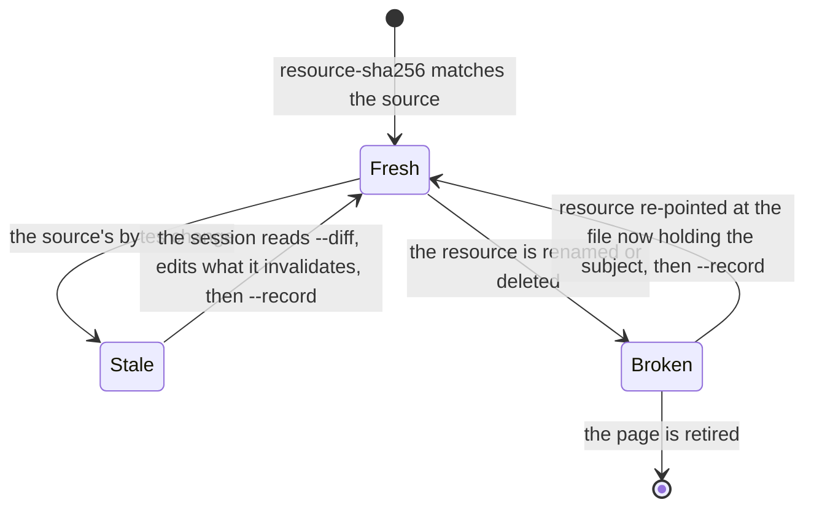
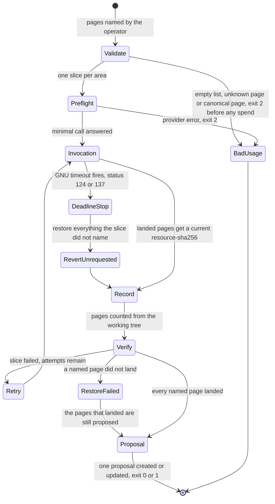
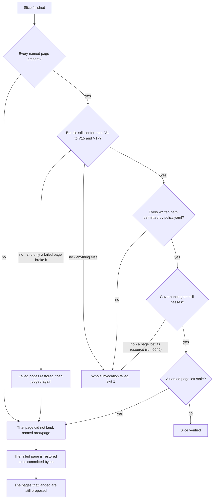

# OpenWiki knowledge-bundle maintenance

**Features 044 and 098** (with the provider and cost work of feature 078, the job deadline of item
#613 and the per-turn output cap of item #719). Since feature 098 (ADR-0004) the bundle is kept current
by **the coding session that changes a summary's source, in the same PR**; the required `okf` check
blocks a PR that leaves a summary stale. The generator remains only as a **manual rebuild of pages an
operator names**, dispatched by hand and paid. The procedures and flags are in
`../../docs/runbooks/wiki-maintenance.md`; the decision and its measured history are in
`../../docs/decisions/ADR-0004-session-maintained-wiki.md`. See
[OpenWiki bundle generation and maintenance](../process/wiki-maintenance.md) for the
`wiki-update`/`okf-lint` Nx targets, and [Nx as the task runner](../invariants/nx-task-runner.md) for
why the bare `openwiki` CLI must never be invoked directly.

## The session's refresh duty

A **derived** page summarises exactly one file, its `resource:`, and records that file's fingerprint as
`resource-sha256:` — the SHA-256 of the file as it sits in the working tree, after CRLF→LF
normalisation, so a Windows checkout does not make every page stale. A **canonical** page has no
`resource`, is listed under `authoritative:` in `openwiki/protected.yaml`, and is maintained by hand.

The refresh is three commands of `scripts/wiki-refresh.mjs` — offline, free and model-free, and it
rejects an unknown flag rather than act on it:

```bash
node scripts/wiki-refresh.mjs --stale             # which derived pages are not fresh; exit 1 if any
node scripts/wiki-refresh.mjs --diff <page>       # the source's change since the page was last recorded
node scripts/wiki-refresh.mjs --record <page>     # write resource-sha256 and timestamp; never the body
```

Between `--diff` and `--record` the session edits **only what the diff invalidates**, following
`openwiki/INSTRUCTIONS.md`. A **fingerprint-only** record is the honest result when the diff changes
nothing the page says — a reformat, a reworded comment, code the page does not describe — and it is
visible to the reviewer as exactly that. `--diff` diffs from the newest commit whose bytes match the
recorded fingerprint; a page with no fingerprint yet diffs from the newest source commit at or before
its stamp, and says so on its `base:` line. Several pages can share a source —
`docs/MCM-Architecture.md` feeds three — and `--stale` names each. Only `--record` ever writes a hash.
The procedure is taught by the `wiki-refresh` skill (`.claude/skills/wiki-refresh/SKILL.md`).



A derived page's three states. V17 fails a PR on any page in `Stale` or `Broken`, or with no
fingerprint at all.

**V17** (`scripts/check-openwiki-okf.mjs`, the required `guardrails / okf` context) fails a derived page
whose fingerprint is missing or not 64 lowercase hex, does not match the source, names a `resource`
that no longer exists, names a directory, or that still carries the retired `sources:` or `verified:`
fields — each with the command that fixes it. `--stale` and V17 call the same function
(`staleDerivedPages` in `scripts/openwiki-fingerprint.mjs`), so the tool and the check cannot disagree.
V17 replaced V12, a commit-date drift **warning** that never failed a build, which is how drift used to
accumulate on `main` between generator runs. **G14** (`scripts/check-openwiki-governance.mjs`) fails a
derived page whose `resource` is a directory or a file a bot rewrites — the files Renovate's default
managers match (manifests, lockfiles, Dockerfiles, compose files, workflows, `renovate.json`, toolchain
pins), CD's `**/.env.deploy`, and every `managerFilePatterns` entry in `renovate.json`'s `customManagers`,
read at check time — because otherwise a bot's PR would go red on V17 with no session there to refresh
the page.

**What was retired (feature 098).** openwiki's bookkeeping is deleted and gitignored: the Claims
sidecars under `openwiki/.claims/`, `openwiki/.page-manifest.json`, `openwiki/.last-update.json`, the run
record `openwiki/.maintenance-state.json`, and the `sources:`/`verified:` front-matter fields. So are
the checks that existed for it — V16 (Claims durability), V12 and G13 (Claims only on derived pages) —
and the unattended machinery around the generator: the daily schedule and its quiet-trigger, range
planning and the run marker, the backlog, low-effort escalation, refresh cooldowns, drift re-planning and
parking, the Claims audit and `.openwikiignore`. The trigger was cost and starvation: $167.80 over 106
runs in 30 days for 39 distinct pages, and run 5104 paying about $1.44 for one landed page while 30
Claims-forced pages crowded out the 4 requested ones. `openwiki/policy.yaml`'s `openwiki/**` entry is
now `actor: [agent, generator]`; G3 still confines `generator` to `openwiki/`.

**Not adopted: openwiki's Claude Code integration** (`openwiki integrations install claude`, item #515).
It would move wiki maintenance onto the subscription. After 098, routine refreshes already are
subscription-side session edits. Only the rare dispatched rebuild is left, and a second execution path
for it would break the `local parity` single-entry-point guard and write into the project's agent
configuration for almost no saving.

**Live state is read, never quoted.** A rebuild's report and `.run.json`, and whatever sidecars openwiki
writes on a runner, are rewritten by the next run, so a page describes what their fields *mean*, never a
current outcome, cost or call count (`openwiki/INSTRUCTIONS.md` §9). Proposal #737 published such a
snapshot in this very page, already false when proposed. A *measured* value that explains why a rule
exists belongs in the source runbook, dated and with its run number, and the page cites it from there.

## A manual rebuild

A rebuild is for a page that needs **regenerating** rather than refreshing — a new page, or one so far
behind that a hand refresh would be a rewrite. It is dispatched by hand: `.forgejo/workflows/wiki-maintain.yml`
has no schedule (removed 2026-11-10, PR #980) and no push trigger, and its required **`pages`** input is
a comma-separated `area/page.md` list, checked against a fixed character class before it reaches a shell.
Locally it is `pnpm nx wiki-maintain infrastructure-as-code --args="--pages <list>"`, with `--dry-run`
to print the exact command per slice and invoke nothing.



The states a rebuild moves through. Nothing is carried between rebuilds: a page that did not land is
reported under `not landed:` and is simply dispatched again.

**Telemetry is opted out, and the opt-out is checked on every invocation (item #516).** Unless
`OPENWIKI_TELEMETRY_DISABLED` or `DO_NOT_TRACK` is truthy, openwiki sends one anonymous `openwiki_run`
event per run to PostHog. The event carries run, build and failure-enum facts, and no repository
content.

- **The launcher.** `scripts/wiki-generate.mjs` forces both variables on, whatever the caller set, and
  always passes `--telemetry-file`. It exits 3 unless the record reads `{disabled: true, sent: false}`.
- **The orchestrator.** `wiki-maintain` gives each invocation its own record path
  (`WIKI_TELEMETRY_FILE`), because it ignores the generator's exit status. On a bad record it stops
  the rebuild without retrying and exits 1 with a `TELEMETRY:` line.
- **What the record proves.** A run stopped before openwiki's telemetry boundary, such as one with a
  missing credential, writes no record and is not judged.
- **Why it is permanent.** It catches an openwiki upgrade that stops honouring the variables. The
  runbook holds the dated $0 measurement on 0.7.1 (an invalid-key probe) and the full payload.
  `--telemetry-file` records the send rather than preventing it, so never run it with the opt-out
  unset to "see what is sent".

## The provider is configuration (feature 078)

Which model writes the bundle is not code: `scripts/wiki-provider.mjs` is the single table, resolved in
**one pure place** from `MCM_WIKI_PROVIDER`.

| `MCM_WIKI_PROVIDER` | Model | Key (first non-empty; mapped at the point of use) |
|---|---|---|
| `anthropic` — the **local** default (unset) | `claude-sonnet-5` | `ANTHROPIC_API_KEY`, `MCM_ANTHROPIC_API_KEY` |
| `fireworks` — the **CI** default (the workflow sets it, at page concurrency 4) | `accounts/fireworks/models/deepseek-v4p1-flash` | `FIREWORKS_API_KEY`, `MCM_FIREWORKS_API_KEY` |

The chosen credential is mapped to the name the generator reads **only** in the generator's own
environment, and every other provider's key is removed from it. The three operator knobs are validated
before any paid call, and each is declared **per provider row** rather than globally: setting the
service tier or the reasoning effort on a provider that does not take it is an error rather than
something quietly ignored, while page concurrency is validated against one 1–8 bound for every provider
alike. The per-turn output cap is the same idea in the other direction: not an operator variable at
all, but a property of the row, and one that may only ever *raise* the target's floor.

- `MCM_WIKI_PAGE_CONCURRENCY` (1–8, default 1) — openwiki ≥ 0.6.0 writes that many pages in parallel.
  DeepSeek's wall-clock gap to Sonnet is **call count** rather than latency, so concurrency is the lever
  that closes it.
- `MCM_WIKI_SERVICE_TIER=priority` (Fireworks only) — +25% price; measured on this workload it bought
  **no** speed, so it is not the default.
- `MCM_WIKI_REASONING_EFFORT` (Fireworks only: `none`, `low`, `high`, `max`; unset = the model's own
  default, which is `high` for this model) — the item-#525 trial knob described next.
- **The per-turn output cap (item #719)** is *not* an operator variable but a property of the provider
  row: the Nx target's `OPENWIKI_MAX_OUTPUT_TOKENS=16384` is a **floor**, and the `fireworks` row
  raises it to **65536** because DeepSeek V4.1 Flash reasons *inside* its output budget. Dispatch 5115
  (2026-10-11) measured why: this very page's worker ended **both** attempts with `finish: length` at
  exactly 16384 output tokens (5,891 reasoning plus ~10.5k of page text) before the `write_file` turn,
  which openwiki reports as "exited without submitting" — the 2026-08 4096 defect recurring at a higher
  cap (PR #732). The `anthropic` row deliberately has **no** raise: the Anthropic TypeScript SDK
  refuses a **non-streaming** request whose `max_tokens` implies more than ten minutes (~21k), so a
  higher global cap could break that provider outright. Output tokens are billed only when generated,
  so the raise costs nothing on turns that do not need it, and a provider may only ever *raise* the
  target's value, never lower an explicit higher operator one. The launcher holds the same line at
  start-up: `scripts/wiki-generate.mjs` refuses to start the generator at all when
  `OPENWIKI_MAX_OUTPUT_TOKENS` is absent, non-numeric or below 16384 (`MIN_OUTPUT_TOKENS`), so
  invoking the launcher directly — outside the Nx target whose `env` is the only place that sets the
  cap — fails loudly instead of quietly reinstating the 4096 defect.

**The reasoning-effort knob (item #525).** `scripts/wiki-provider.mjs` rejects any value Fireworks does
not document for this model, so a bad value fails before any paid work. It cannot travel as openwiki's own
`OPENWIKI_REASONING_EFFORT`, because openwiki refuses an effort for its `fireworks` provider — true in
0.6.0 and still true in the pinned 0.7.1 (078 research R15) — so the **usage tap**
(`scripts/wiki-usage-tap.mjs`), loaded into the generator process, sets `reasoning_effort`
on the Fireworks chat-completions request bodies instead — exactly the route `MCM_WIKI_SERVICE_TIER`
already uses. The preflight sends it too, so a value the provider rejects fails before paid work. The
run's usage line and its record carry `effort=<value>` when it is set, and the effort changes no price
row, because Fireworks bills reasoning as output tokens. **It is under trial:** latency is roughly output
tokens ÷ generation speed, and a lower effort means fewer reasoning tokens per call — but possibly a
weaker page. In CI it is the `reasoning-effort` **input of a dispatch**, applied to every invocation of
that run; without it the repository variable applies, which stays unset — the model default. Do not set
the repository variable until a trial's page has been reviewed.

The launcher also *imposes* one variable the operator never sets: it puts
`OPENWIKI_PROVIDER_RETRY_ATTEMPTS=2` into the generator's environment unless an explicit operator value
is already there (see the hang below).

**A malformed value exits 2 — it is never read as a default**, because a mis-typed selector that fell
back would bill the wrong vendor with no signal. An empty value is unset (how an Actions repository
variable that was never set arrives). In CI these are repository **variables**, so switching provider is
a settings change, not a commit; the keys are the secrets `ANTHROPIC_API_WIKI_MAINTAIN` and
`FIREWORKS_API_WIKI_MAINTAIN`.

**Why the Nx target names no provider.** Nx builds a target's child env as
`{ ...process.env, ...targetEnv }`, so a provider in the target's `env` would silently overwrite the
job's choice — the job could set a provider and the generator would never see it. The target therefore
runs `scripts/wiki-generate.mjs`, which resolves the table, hands the generator only the selected
provider's key, and passes `WIKI_RUN_MESSAGE` as one argv element with no shell. The resolution is also
one-way: the launcher writes the resolved `OPENWIKI_PROVIDER`/`OPENWIKI_MODEL_ID`/`OPENWIKI_PAGE_CONCURRENCY`
into the child env, so a stray `OPENWIKI_PROVIDER` inherited from the caller cannot override the
provider the selector resolved to. See
[Model-provider environment scoping](../invariants/model-provider-scoping.md) for the analogous
env-scoping rule on the agent side.

**The generator itself is pinned in two places, and they must agree.** The dev container bakes a global
`openwiki@0.7.1` **plus `mermaid` and `jsdom`** into its toolchain image (`.devcontainer/toolchain.Dockerfile`);
the CI runner has no generator baked in, so the wiki-maintain job installs one **from a committed
lockfile, never resolved at run time** (item #704). `tools/openwiki-generator/` holds three exact pins
(`openwiki` 0.7.1 and its optional Mermaid peers `mermaid` and `jsdom`) plus the `pnpm-lock.yaml` for
that tree; the job runs `pnpm --dir tools/openwiki-generator install --frozen-lockfile`, puts that
directory's `node_modules/.bin` on `PATH`, and its verify step fails unless `command -v openwiki`
resolves there. The guard test reads the dev container's real install command line against the locked
manifest and lockfile, and asserts the same version and the same peer-dependency set on both sides — an
unpinned or divergent generator means CI and a developer's container silently differ on the thing whose
output is gated, and a missing parser silently downgrades diagrams.

Why the lock: the step used to be `npm install -g openwiki@0.7.1 mermaid jsdom`, which pinned only
`openwiki` and resolved its whole transitive tree (`openai`, `deepagents`, `langsmith`, …) plus the two
peers to whatever was newest at run time. Run 4950 (2026-10-09) died 404-ing on `openai@7.32.0`,
resolved two minutes after it was published, and the same gap let a minutes-old package run with the
generator's model credential in its environment. Two runs a day apart could also run different
generator code with no diff in this repository, confounding every cost and reliability comparison.

**The cooldown.** `tools/openwiki-generator/` is its **own** pnpm workspace root — its own
`pnpm-workspace.yaml`, outside the root workspace's `frontend/*` and `packages/*` globs — so the root's
settings (which deliberately set no cooldown) do not apply and its own do. It sets
`minimumReleaseAge: 4320` (three days, Renovate's catch-all), which pnpm enforces twice: at **resolve**
time, so a lockfile regeneration cannot pick a transitive younger than three days (the gap item #271
describes for the root workspace, closed for this directory), and at **install** time, where a frozen
install fails `ERR_PNPM_MINIMUM_RELEASE_AGE_VIOLATION` rather than install a locked entry inside the
window. `minimumReleaseAgeExclude` is reserved for **security-floor exceptions**, because this code runs
with the generator's model credential: each entry is one exact `name@x.y.z` that an `overrides:` floor in
the same file requires, so it admits that version and nothing else, and it becomes moot once the version
clears the window. The guard fails a name-only or ranged entry, or one with no matching floor. **No entry
is present today.** The only one so far, `@azure/identity@4.14.1` (an operator override of the cooldown on
2026-11-01, published 2026-10-29 22:16 UTC, the first release requiring `@azure/msal-node` ^7.1.0 for
GHSA-xcx6-jx8p-x3h5), was removed on 2026-11-02 once it cleared the window; its `overrides:` floor stays,
because the floor is the fix and the exclusion only let it in early. Never add one because a fresh
transitive is blocking a branch — wait the window out. `better-sqlite3` is the one package allowed to run
an install script (`allowBuilds`), because openwiki's LangGraph checkpointer loads its native binding at
runtime.

**Being its own root cuts both ways: the cooldown is local, and so is every floor.** The same fact that
lets this directory set a cooldown the root deliberately does not have means the root's `overrides:` map
does not reach it, so a security floor the generator's tree needs is repeated in this file. Item #840 did
exactly that — `body-parser@>=2.0.0 <2.4.0: '>=2.4.0 <3'` for GHSA-27r3-jxmh-p828 (a DoS via trailing bytes
after a compressed body, fixed in 2.4.0), reached through `express` 5 via `@modelcontextprotocol/sdk`; it
is the same keyed-range-on-range entry the root workspace carries, capped within the major. A later
operator override added `'@azure/identity@<4.14.1': '>=4.14.1 <5'` for GHSA-xcx6-jx8p-x3h5. The floor and
the cooldown interact: the fixed version has to clear this workspace's own three-day window before the
floor can resolve at all, so a floor added the day a fix ships sits inert until then rather than failing
the install. Note what is *not* inherited either: `check-override-consistency.mjs` reads the **root**
`pnpm-workspace.yaml`, so neither the key/value half-bump rule nor the major-cap rule is applied to this
file — the floor is duplicated by hand and its halves must be moved together by hand. The same nested-root
fact is why the SCA audit set is discovered from git instead of hard-coded, and why a *root* override never
yields lockfile advice for a finding in this tree — see
[SAST & SCA static scanning](sast-scanning.md).

**Checking the cooldown yourself** (the live half of the proof; the static half is
`scripts/__tests__/wiki-maintain.guard.test.mjs`, which fails a cooldown under three days, an exclusion
that is not an exact, floor-backed version, a range instead of an exact pin, a lockfile that disagrees
with the manifest, a root workspace glob that swallows this directory, or any run-time resolution in the
workflow). Copy the three files somewhere scratch, raise the window past the age of the lock, and install
frozen — **from the repository root**, with `--dir`, so corepack picks this repository's pnpm:

```bash
d=$(mktemp -d) && cp tools/openwiki-generator/{package.json,pnpm-lock.yaml,pnpm-workspace.yaml} "$d"/
sed -i 's/minimumReleaseAge: .*/minimumReleaseAge: 525600/' "$d/pnpm-workspace.yaml"
CI=true pnpm --dir "$d" install --frozen-lockfile; echo "exit=$?"   # expect exit=1 and the violation list
```

On 2026-10-10 that exited 1 with `[ERR_PNPM_MINIMUM_RELEASE_AGE_VIOLATION] 203 lockfile entries failed
verification`; the same install with the committed window succeeds. Bumping by hand is
`pnpm --dir tools/openwiki-generator add openwiki@<v> --save-exact` (or `mermaid`/`jsdom`), plus the
same edit to the dev container's `npm install -g openwiki@<v>`, then the guard with
`OPENWIKI_ROOT=$PWD/tools/openwiki-generator/node_modules/openwiki` — Renovate normally does both in one
grouped `openwiki generator` PR.

0.6.0 was the first version with parallel page workers (`OPENWIKI_PAGE_CONCURRENCY`); the 2026-10-07
amendment moved the pin to 0.7.1, which adds the worker retry (upstream #913) — a page worker that exits
without submitting is retried once, with the page and its Claims restored between attempts, at the cost
of up to two workers' time and money for a page that never submits, which raises the deadline-stop risk
on exactly those pages — and scoped planning (upstream #865), where a run message that names pages is
treated as a hard mandate rather than a hint (078 research R15). The dev container's global copy is still resolved fresh **at image build**, which
is rebuilt rarely and never holds a CI credential; local runs use it by default, and putting
`tools/openwiki-generator/node_modules/.bin` first on `PATH` runs the locked tree locally instead.

**Preflight.** Before the first paid slice, a rebuild makes one minimal call to the
selected model (`node scripts/wiki-generate.mjs --preflight` by hand). A failure exits **2** with
nothing else spent and names the provider's error type — a withdrawn model id, a revoked key or a blocked
egress host costs one token, not a slice. The launcher's argument surface is deliberately one flag
wide: `--preflight` is the only argument it accepts and anything else is rejected outright, because a
flag it did not recognise must never be read as "start a paid run" (the `--help`/`--dry-run` lesson
recorded in `CLAUDE.md`). The preflight sends only what a real run sends — no `temperature`, which
Sonnet 5 rejects with a 400 — so it cannot fail for a reason a real run would not.

## What the exit codes mean

| Code | Meaning | Is something wrong? |
|---|---|---|
| `0` | Every named page landed and verified (or `--dry-run`, or a selftest that passed) | No |
| `1` | A named page **did not land** — missing or left stale, the bundle became non-conformant or broke governance, a write landed where policy forbids it — or the proposal could not be published, or the generator's telemetry record shows an event was sent | **Yes** — `not landed:` says which; a `TELEMETRY:` line names the telemetry case |
| `2` | Bad usage (an empty, unknown or canonical page included), a missing credential, a malformed `MCM_WIKI_*` value or `WIKI_JOB_DEADLINE`, a failed preflight, or a policy file that will not load. Nothing was spent | **Yes** |

There is no exit 3 any more: it meant "stopped at the budget with work in the backlog", and there is no
backlog.

### How a slice is verified



The checks a finished slice must clear. Only the page-attributable ones are attributable to a *page*: a
conformance, policy or governance failure is the whole invocation's, so it proposes nothing — with one
exception, the conformance break that turns out to be a failed page's own.

Verification never consults the generator's own exit status; it looks only at what landed in the
working tree and at the bundle's gates. The contract is the pages the slice *named*, not "some page
appeared": a run that wrote unrelated pages while ignoring the request fails, and an `index.md` alone
counts as zero pages — exactly feature 043's false-green run, 12 minutes of paid work, one `index.md`,
exit 0, reported as success. Each landed page's fingerprint is recorded **before** the conformance
check reads the bundle, so V17 fails only a page the run left stale or did not name. A named page left
unwritten, or changed only in front matter, is named as stale one page at a time **whether or not the
run changed the file** (items #587, #616), so a multi-page slice does not pass because *some* of its
pages were written; writing nothing is still honest for a page whose source has not moved, which is the
`✅ … nothing needed changing` line. **The governance gate is a verifier too (PR #857):** on run 6049
a regenerated `projects/bff.md` that had lost its `resource:` stayed OKF-conformant, passed a verifier
that ran the OKF gate alone, and was proposed — then guardrails failed it on **G11**, because a concept
with no determinable home has nowhere for a learning to go. `verifySlice` now also runs
`check-openwiki-governance.mjs --root`, skipped out loud only for a fixture bundle with no
`protected.yaml`.

**Landing is judged per page (items #685, #720).** When a failure is attributable to particular pages
while conformance, policy and governance are clean, `failedPages` names the pages that did not land and
every other named page — area-mates included — is proposed. Each failed page is first restored to its
committed bytes so it cannot ride along on that proposal, which stages the whole working tree (#684,
run 4801). Run 5010 (2026-10-10) set this shape: one page in `runbooks/` exited without submitting, and
two completed area-mates were thrown away with it. The area's `index.md` is not restored, since it
lists the failed page and its landed area-mates alike. Left alone, and so still possible on a proposal:
a failed page that was dirty **before** the invocation, and an **untracked** new page.

**A slice keeps only what it named.** A generator stopped part-way (GNU `timeout` exit 124, or 137
after `--kill-after`) can leave a page it was never asked for half-written; on run 4606 (2026-10-04) that
broke conformance on `projects/keycloak.md`, a whole-invocation failure, and the requested page's $0.96
regeneration was lost. After a **deadline stop**, `revertUnrequested` restores every bundle path the run
changed (or deletes it if new), except the named pages and their areas' `index.md`. After a run that
exits **on its own**, it puts back only unrequested concept pages the policy lets the generator write, and
leaves a forbidden write in place so verification still fails on it. Paths dirty before the run are left
alone either way.

### The job deadline, and how big a rebuild should be

The workflow records `WIKI_JOB_DEADLINE`; each invocation runs under GNU `timeout` with the time left
minus an 8-minute reserve for verification and publishing, and one with under 5 minutes left is not
started. `timeout` signals the whole process group, which matters because nx starts openwiki as a
grandchild. **Name few pages per dispatch**: over 85 single-invocation runs from 2026-10-08, 37 % of 1–2
page invocations, 46 % of 3–4 and 69 % of 5–8 stopped at the deadline, and no invocation of 5 or more
pages ever ended on its own. Sizing by the cited sources' line count was measured and rejected (a
correlation of 0.39 with duration, no better than page count's 0.37), and the same page varies up to
4.3× from run to run. A page with no prior coverage needs about 1.65× the output per call; rebuild those
one per dispatch. Nothing here is a monetary bound: a run records an estimated cost, but that is a
measurement, not a limit — the deadline bounds the one shared runner's occupancy.

**Why a run once hung for an hour (2026-09-30).** For an OpenAI-compatible provider openwiki sets no
request timeout, so the OpenAI SDK's 10-minute default applies, and at page concurrency above 1 openwiki
retries 5 times — one request accepted and never answered was about 60 silent minutes. The launcher
puts `OPENWIKI_PROVIDER_RETRY_ATTEMPTS=2` into the generator's environment unless an operator value is
already there, bounding that at about 30 minutes; the deadline bounds the rest.

## What a run cost (feature 078)

OpenWiki reports no usage itself, so `scripts/wiki-usage-tap.mjs` is loaded into the generator process
and records per-call **counts** (never content). Each invocation's counts are priced from
`scripts/wiki-provider-prices.json` — a dated table; update `asOf` with every change — and the run total
lands in the job log. The line's shape (the figures below are illustrative; read the job log for a real
run):

```text
[wiki-maintain] usage runbooks/: 47 call(s), 183838 uncached / 2801438 cached / 43117 output tokens, ~$0.0883 (fireworks, prices 2026-10-07)
[wiki-maintain] run usage: ~$0.0883 over 47 call(s) in 1 invocation(s), fireworks, prices 2026-10-07
```

It is an **estimate**, and the two halves have different track records. The *token counts* are the
trustworthy half: on the 078 probes they reconciled with the Fireworks bill to the cent, and across the
45-run scoring window they matched the console to chart-reading precision. The *rates* were wrong once —
the 2026-09-27 table priced every day of 2026-10-01…07 at 1.43× under the bill — so the operator settled
the standard rates from the Fireworks website on 2026-10-07, after which the same tokens re-price to
−0.8% of the bill. A guard re-prices that window and fails beyond 5% of the bill, so a rate change is a
code change to `scripts/wiki-provider-prices.json` and its `asOf` date, never a quiet drift.

`not captured` means the tap produced nothing — it is never written as $0. A line saying `PARTIAL total`
means some invocations were not captured. `failedCalls` counts non-200 responses: rate limiting under
page concurrency shows up there first. When the reasoning-effort knob is set, both the per-invocation and
the run line carry `effort=<value>` after the provider (and tier, if any) — it changes no price row,
because Fireworks bills reasoning tokens as output tokens.

**The per-call lines themselves are kept in the evidence bundle (item #682), and each names its page
(item #719).** In CI, each invocation's tap lines are appended to the job's step log `wiki-usage.log`,
under a `# invocation pages=… effort=…` header, so they arrive in `ci-failures:<runId>--maintain` as
`step:wiki-usage` (`node scripts/ci-status.mjs failure --run <id> --full`; a dispatched run posts no
commit status, so fetch the bundle from the package list instead). Until 2026-10-10 only the sum
survived — run 4960 failed after 447 calls with nothing finer to read. Counts, status and timing only,
like the tap itself; nothing is written outside CI.

Four page workers run concurrently, so a line is useful only if it says whose call it was. A page
worker's line carries `page` (the bundle path openwiki names in the worker's prompt, "You own exactly
/openwiki/…"), `finish` (the response's finish or stop reason, from a fixed set, else `other`), `tools`
(the names of the tools it called — only names the request declared, else `undeclared`) and `badArgs`
(how many of those calls' arguments do not parse as JSON). Still no content: no prompt, response,
argument or error text. `uncached + cached` is the prompt size; prompts of 170–260k tokens are routine,
so prompt size alone has not explained a failure (#719).

For every page that did not land, the run prints the worker's trail to the job log:

```text
[wiki-maintain] worker trail runbooks/renovate.md: 61 call(s), max prompt 241113, never called submit_page — last: tool_calls[write_file] → tool_calls[read_file] → stop[]
```

That tells apart the three ways a worker ends without submitting: a truncated turn (`length`), a turn
that simply stopped with no tool call (`stop[]`), and a tool call whose arguments do not parse
(`✗args`) — an error openwiki 0.7.1 swallows into the same "exited without submitting" outcome. `length`
is the signature of the output-cap defect of item #719, and reading it is what produced the raise to
65536 on the Fireworks row (PR #732); it stays the first thing to look at if pages stop landing again.
The figures in the example are illustrative.

## Gotchas

- **A filename is not a specification.** Where a subject is known, the run message carries a one-line
  subject per page — without one, the generator spends its whole budget working out what a page should
  say; measured across the feature-044 relocation, that single change was the difference between 0 pages
  in 643s and 3 pages in 367s.
- **A slice is retried up to 3 times within one run before its pages are reported `not landed`**, and
  the attempt count is always reported. A retry can never forgive what an earlier attempt did: the
  working tree is snapshotted once, before the first attempt, so a forbidden write on attempt 1 still
  fails the slice even if attempt 2 behaves — re-snapshotting per attempt was tried and it laundered a
  policy violation into a success. **A rate-limited attempt waits instead of retrying at once (item
  #683):** a failed attempt where at least half of its calls answered HTTP **429** is recognised from the
  usage tap's per-call `status` — never from the generator's text — and the retry waits 60 s (120 s before
  a third attempt), but only while the generator would still have its 5 minutes before the job deadline.
  The ~50% "miss" rate measured during feature 044 was not genuine non-determinism but a fixed bug — the
  model id then pinned was absent from `@langchain/anthropic`'s table, so every turn was silently capped
  at 4096 output tokens and truncated before it could open a tool call. OpenWiki 0.5.2 fixed the cause
  upstream, and `wiki-update` additionally sets `OPENWIKI_MAX_OUTPUT_TOKENS=16384` itself — a **floor**
  that the `fireworks` row raises to 65536 (item #719). **If zero-page runs return, measure the wire —
  `stop_reason` and `output_tokens` on a pass-through proxy — not the retry count.**

- **The model pin has made a round trip, and both moves were deliberate.** Feature 043 pinned
  `claude-sonnet-5`; the 2026-08-01 fix moved it to `claude-sonnet-4-6` (an id the vendor table *did*
  match, the only way to escape the 4096 fallback before an explicit cap existed); feature 075
  (2026-09-21) moved it back. A reference to `claude-sonnet-4-6` in an older document or commit is that
  middle period, not a conflicting pin. The move back was **cost-only**: same vendor, same credential,
  same workflow, same Deep Agents caching middleware, only the id changed. Sonnet 5 lists at $2/$10 per
  MTok against Sonnet 4.6's $3/$15, with cache reads at $0.20/MTok against $0.30. Generation is the
  largest line on the model bill (~53% of a measured $74.89 over the 30 days to 2026-09-20) and already
  ~92% cache reads, so the *cached-read* rate — not the list input price — was the number that decided
  it: roughly −33%, from ≈$1.72 to ≈$1.15 per run-day. **OpenWiki sends no `temperature` parameter,
  which is why this bump was safe where the agent gateway's equivalent bump was not** — Sonnet 5 and
  Opus 5 reject `temperature` with a 400, and the gateway sent it unconditionally. A model id is only a
  drop-in for the parameters the caller actually sends; if OpenWiki ever starts sending sampling
  parameters, re-check this before bumping the pin again.
- **Read the guard's SKIP COUNT, not just the exit code.**
  `scripts/__tests__/wiki-maintain.guard.test.mjs` asserts, for the pinned generation model, that the
  explicit cap is set and at or above the 16384-token minimum a page-writing turn needs, that
  OpenWiki's own `resolveAnthropicMaxOutputTokens` still matches the pinned id, and that the id would
  not resolve to `@langchain/anthropic`'s 4096-token fallback if the explicit cap were removed. It also
  asserts, provider by provider, that the target's cap reaches the generator and that a provider may only
  ever **raise** it (item #719: 65536 on `fireworks`, unchanged on `anthropic`), so a row that quietly
  lowered the floor fails offline. Two of
  its four cap-related tests **skip** when OpenWiki is absent from `/usr/local/lib/node_modules` — and
  now also when the installed version is not the pinned one — so a skip can misleadingly read as a
  pass. Point `OPENWIKI_ROOT` at a side install of the pinned version (`npm install -g --prefix <dir>
  openwiki@<v> mermaid jsdom`) to make them run; the `claude-sonnet-5` bump was verified at 20 passed /
  0 failed / 0 skipped. The wiki-maintain CI job runs this guard after installing the generator and
  before any paid work, and **fails the step on a skip**, reading node's `# skipped 0` summary line.
- **The managed `<!-- OPENWIKI:START -->…<!-- OPENWIKI:END -->` block is rewritten on every run, so the
  committed block must already be what the pinned generator writes.** OpenWiki rewrites that block in
  `AGENTS.md` and `CLAUDE.md` on every run, and 0.6.0 changed the `AGENTS.md` text (four lines about its
  retrieval tools; 0.7.1 leaves it unchanged). `openwiki/policy.yaml` permits only `actor: agent` to write
  `AGENTS.md`, so on a generator whose text differs
  **every slice** would have failed verification (`AGENTS.md — the run may not write here`) and been
  retried — run after run, at full cost.
  The fix is that the committed block *is* the pinned generator's text (an agent-authored edit, which
  the policy allows), which makes the rewrite byte-identical and therefore not a write at all.
  `scripts/__tests__/wiki-maintain.guard.test.mjs` now rebuilds both blocks from the installed
  generator's own source and compares them byte-for-byte, so the next version bump that changes the text
  fails **offline** instead of failing every paid run in CI: update the block in the same change as the
  pin. The pinned-version checks skip wherever the pinned generator is not installed, which is why the
  wiki-maintain job — the one place it *is* installed — runs this guard before any paid call and fails
  the step on a skip.

- **A page that passes the OKF gate can still be refused by the governance gate, so the verifier runs
  both (PR #857, run 6049).** On that run the generator rewrote `projects/bff.md` *without* its
  `resource:` — and without its `description` and `tags`. The page stayed OKF-conformant, so
  `verifySlice` passed it and the run opened a pull request that guardrails then failed on **G11**
  ("neither derived nor authoritative"). The gate that would have refused it already existed; the
  verifier simply never called it. `verifySlice` now also runs
  `node scripts/check-openwiki-governance.mjs --root <root>`, because those rules span the whole
  repository — the bundle, `CLAUDE.md`/`AGENTS.md` and the two governance files — and not just the
  bundle the OKF gate is pointed at. A governance break is a **whole-invocation** failure, like policy:
  it proposes nothing and returns every page. The one exception is a fixture bundle with no
  `protected.yaml` (a pre-governance test fixture, not a weakened production run), where the check is
  skipped and says so out loud rather than silently passing. This is the same family as the canonical-home
  rule below: a concept with no determinable home has nowhere for a learning to go, which is why G11
  refuses it.
- **A page whose front matter openwiki *rebuilt* has its repository keys restored from `HEAD` before
  the gates read it (item #777).** openwiki 0.7.1 repairs a page whose model-written YAML does not parse
  by silently rebuilding a minimal header — `type: "Reference"`, a quoted `title`, `openwiki_generated: true` —
  dropping `resource`, `description` and `tags`, and it does not tell the agent. That is the real cause of
  the G11 failures on #775, #791 and #857, and the brief cannot guarantee valid YAML from a model, so the
  harness fixes it deterministically the way it fixes link form: on any page the slice wrote that carries
  the `openwiki_generated: true` rebuild marker, `verifySlice` restores `type`, `description`, `resource`,
  `tags` and `timestamp` from `HEAD` (taking `HEAD`'s `type`, since the rebuild's `"Reference"` is a
  fallback rather than a classification), and removes the marker — logging `restored … from HEAD in <page>`. **Only** on that marker: a page
  that dropped `resource:` without it is the model's own edit, and the governance gate still refuses it in
  the run, so the #857 guard keeps its meaning. A brand-new page (not at `HEAD`) carrying the marker is left
  alone, since there is nothing to restore from.
- **Remediation is always the brief, never an allowlist.** If a page trips the conformance gate, a leak
  scan, or the governance gate, fix the page (and `openwiki/INSTRUCTIONS.md`, for a rebuild) — the gates have no skip flag
  by design, because an allowlisted leak stays leaked.

- **Under a dispatch, read nothing from the event payload except its inputs.** A scheduled fire carried
  no repository in its payload, so setting `FORGE_REPO` from that field made every fire fail at the forge
  client (runs 6539–6569). Owner and repo come from `GITHUB_REPOSITORY`, which the runner sets for every
  event, and a guard test fails on any other `github.event.*` read. The dispatch inputs (`pages`,
  `reasoning-effort`) arrive as environment variables, never interpolated into a run block.
- **The proposal is one long-lived branch (`openwiki-maintenance`), at most one open pull request, ever,
  and never auto-merged.** The runner is a fresh checkout, so the branch exists there only on the
  **remote**: the run checks it out from there, and only while its proposal is **open**. Until 2026-09-28
  it looked only for a *local* branch, found none on every CI run, started from `main`, and the
  `--force-with-lease` push replaced the open proposal (proposal #594). A run that finds it open
  continues the remote branch, rebases it onto the base and appends — so a reviewer's commit survives
  every later update — and the push refuses outright (`pushing would discard N commit(s) from open
  proposal`) when the open proposal holds a commit the new head lacks: a red run, never a silent
  overwrite. **The forge is the only state:** which proposal is open is asked of the forge on every run,
  and a `POST /pulls → 409` is handled by adopting the existing one. (The run record used to cache the
  pointer; it was lost once in a push race and the next run tried to open a second proposal.) Closing the
  proposal unmerged simply discards it. **A reviewer may correct a page in place** — edit it and
  `--record` it in the same commit. Until feature 098 a hand edit of a Claims-covered page made openwiki
  refuse every later run (#606, #610); that bookkeeping is gone.
- **A durable learning goes to the canonical home of its subject.** `openwiki/INSTRUCTIONS.md` §7 states
  the rule: if the concept covering the subject carries a `resource`, write the detail into the cited
  source — the runbook, decision record or architecture document — **and refresh the summary in the same
  PR**; if it carries none, the concept is authoritative and the learning goes into the concept. A
  concept that becomes a copy of its source has failed the generation brief, which is why this page
  states rules and field meanings and defers to `../../docs/runbooks/wiki-maintenance.md` for the
  procedures. The routing decision, and the rejected grow-then-trim alternative, are in
  [Where a new learning goes](../process/wiki-maintenance.md).

- **A protected passage may only live on a concept with no `resource`.** Freezing a derived summary
  against the document it summarizes would fail every legitimate refresh. To change such a passage,
  update its text and its fingerprint in the same change:
  `node scripts/check-openwiki-governance.mjs --fingerprint openwiki/<area>/<page>.md "<heading text>"`.
  See `openwiki/protected.yaml` and the routing rule in
  [where a new learning goes](../process/wiki-maintenance.md).
- **The generator writes site-root-absolute body links (`](/openwiki/…)`) — those are dead on this
  forge.** A leading `/` resolves against the site root, so the forge reads `openwiki` as a username
  and 404s. Measured via `POST /api/v1/markup` (the one endpoint that takes `Context`, `BranchPath`,
  and `FilePath`, rendering a link exactly as the file view does). 204 links across 61 of the
  bundle's 77 files were broken this way while `okf-lint` passed, because V6 verified only the
  `resource` front-matter field, not body links. Three layers now hold the line: `INSTRUCTIONS.md`
  §6 states the convention; `verifySlice` normalises whatever the slice wrote before the gate reads
  it; and `okf-lint` rules **V14** (site-root-absolute) and **V15** (does not resolve from its own
  file's directory) fail the build for anything else. For a bundle-wide sweep (e.g. after restoring
  from elsewhere): `node scripts/wiki-maintain.mjs --normalize-links` (offline, no credential; add
  `--dry-run` to preview). Code fences and code spans are exempt.

- **The page stamp is the newest of `generated.at` and `timestamp`, and it no longer decides
  freshness.** OpenWiki 0.5.x replaced the flat `timestamp:` scalar with a `generated: {by, at}` event,
  stamped on every page whose body changed in a run (and its `timestamp` removed in the same pass), so the
  bundle carries both shapes, one per page; `wiki-refresh.mjs --record` writes `timestamp`, which OKF v0.2
  tolerates. The rule is defined once, in `scripts/openwiki-stamp.mjs`. `verified.at` was a third
  candidate while Claims existed (operator decision 2026-09-28) and is not one now. Freshness is the
  fingerprint's job; the stamp only gives `--diff` its base for a page that has no fingerprint yet.

- **Mermaid and jsdom are optional peer dependencies — missing them causes diagram fences to be
  silently rewritten to plain text fences while the run exits 0.** From OpenWiki 0.5.0, Mermaid
  diagrams are embedded by default and every fence is validated after a run. Without `mermaid` and
  `jsdom` installed alongside the generator, OpenWiki falls back to a weaker built-in check; any
  diagram that fails that check is rewritten in place as a plain `text` fence with a comment — the run
  still exits 0, every gate still passes, and the diagram is silently downgraded. Both packages are
  therefore installed in `.devcontainer/toolchain.Dockerfile` **and** pinned in CI's locked install
  (`tools/openwiki-generator/package.json`). A guard in
  `scripts/__tests__/wiki-maintain.guard.test.mjs` asserts that the two lists match: if only one
  environment has the parser, they disagree about what a valid diagram is, and the environment that
  writes the bundle decides. Both sit **outside** the peer range openwiki 0.7.1 declares
  (`mermaid ^11.16`, `jsdom ^29.1`) — the versions every CI run since mid-September actually resolved.

- **Claims are retired, and a rebuild leaves none behind.** OpenWiki 0.5.2 records Claims — evidence
  for each page in a JSON sidecar under `openwiki/.claims/`, certified against the page's bytes by
  `openwiki/.page-manifest.json` and a front-matter `verified:` event. This repository kept them from
  2026-09-27 to 2026-11-10, guarded by V16 and G13 (ADR-0003). openwiki forces every page with a stale
  Claim into every run whatever was requested, and with about 20 pages a week changing source that forced
  set grew with every merge until it starved the requested pages. ADR-0004 supersedes ADR-0003's Claims
  half; its fingerprint half — `protected.yaml` on authoritative pages, G5–G7 — stands. A rebuild may
  still have openwiki write sidecars and a manifest on the runner: the paths are gitignored, and the
  rebuild strips `sources:`/`verified:` from every page that landed.

## Verifying the machinery itself

The machinery proves itself offline and keyless, so a check on it never needs the paid machinery to
run — exactly when it matters:

```bash
node scripts/check-openwiki-okf.mjs --selftest        # V1–V15 and V17 still detect their cases
node scripts/check-openwiki-governance.mjs --selftest # G1–G12 and G14 still detect their cases
pnpm nx okf-lint infrastructure-as-code               # bundle conformance
pnpm nx okf-governance infrastructure-as-code         # policy, protection, index
node scripts/wiki-maintain.mjs --selftest             # the rebuild's verifier
node --test scripts/__tests__/openwiki-fingerprint.test.mjs scripts/__tests__/wiki-refresh.test.mjs
node --test scripts/__tests__/wiki-maintain.test.mjs scripts/__tests__/wiki-maintain.guard.test.mjs
node --test scripts/__tests__/openwiki-links.test.mjs # body-link scanner and normalizer
```

`wiki-maintain --selftest` drives the verifier against a **deliberately sabotaged generator** that
exits 0 having written nothing — the exact false green feature 043 measured. If a clean verdict ever
comes back, the zero-page detector is broken, which is the one failure mode that would let a rebuild go
quietly back to reporting false green.

Full flags and the CI workflow's proposal logic: `../../docs/runbooks/wiki-maintenance.md`. The
pull-request and CI surface around a proposal is covered by the [CI/CD pipeline](../projects/ci-cd-pipeline.md),
the [feature-validation checklist](../invariants/feature-validation-checklist.md), and the
[devcontainer sandbox](devcontainer-sandbox.md) / [host toolchain setup](dev-environment-setup.md) pages.
