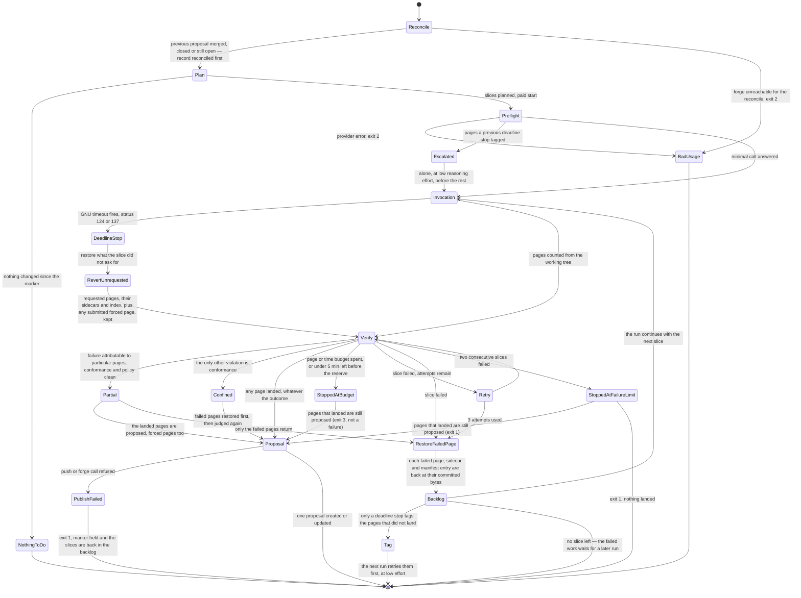
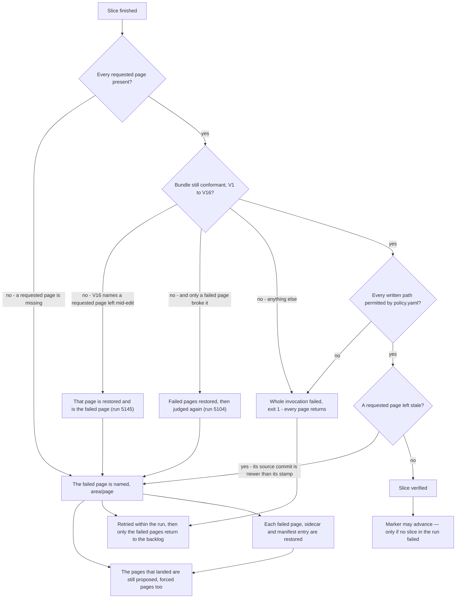
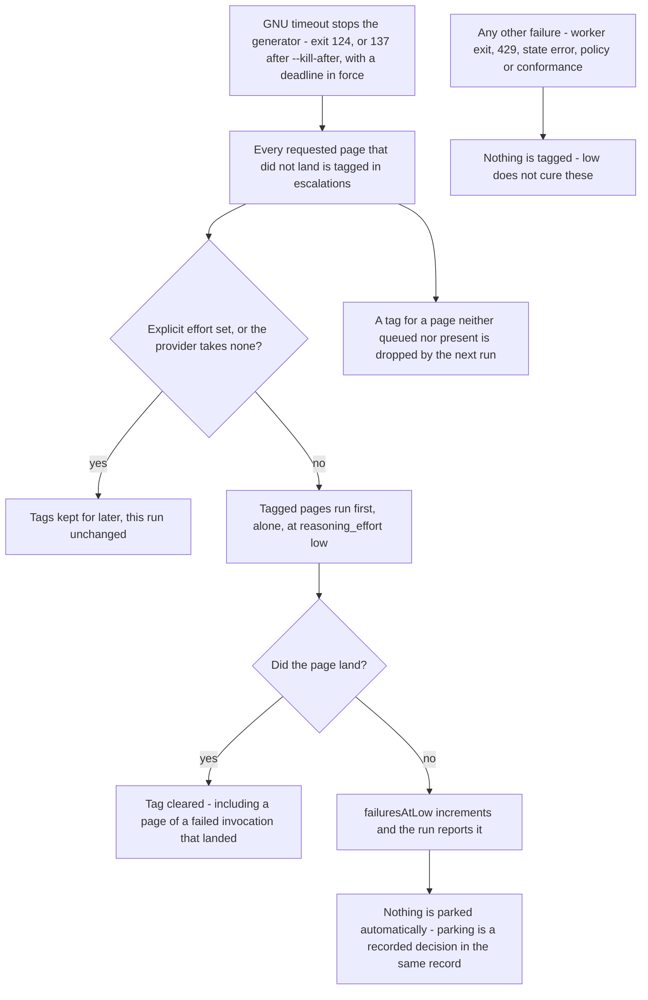

# OpenWiki knowledge-bundle maintenance

**Feature 044** (with the cost/provider work of feature 078, the deadline work of item #613, the
deadline-stop escalation of 078 US6, the drift re-planning and parking of feature 082, the per-turn
output cap of item #719 — raised to 65536 on the Fireworks row in PR #732 — and the overlapping-run
handling of #748).
`pnpm nx wiki-plan infrastructure-as-code`
decomposes the documentation changes since the last recorded run into **slices** — at most 8 pages,
exactly one bundle area each — offline and free, so there is never a reason to skip it before spending
on `pnpm nx wiki-maintain infrastructure-as-code` (paid, needs the selected provider's key). A second
free check answers a different question the plan cannot: `node scripts/wiki-maintain.mjs
--claims-audit` (offline, keyless; `--json` for machines) lists the pages openwiki will *force* into
the next run because one of their cited Claims is stale or unresolved — a full paid regeneration
whatever the plan requested (item #707) — and marks a page whose only issues are churn citations (a
lockfile, a CD digest pin, a line-addressed allowlist entry, a cited range holding an image digest) as
**avoidable**, since `openwiki/INSTRUCTIONS.md` §9 forbids citing those. `.openwikiignore` is a
**separate** mechanism: it lists the paths openwiki may not cite at all, and the audit never reads it —
so a whole-file allowlist citation is ignored but is not churn, and a Dockerfile digest pin is churn but
is not ignored. It runs openwiki's own evidence resolver from the install the `openwiki`
binary on `PATH` belongs to, and exits 2 when there is none. The paid run is bounded three ways: a page budget, a start deadline, and a
per-event **job deadline** that a
merge-triggered run and a dispatched run are each given differently. The run
record lives at `openwiki/.maintenance-state.json`, committed because runners are ephemeral; it is
distinct from the tool's own `openwiki/.last-update.json`. Besides `coveredCommit` it carries the
`backlog`, the `escalations` tags a deadline stop writes, the `parked` entries that take a page out of
planning entirely, the open `proposal` pointer with the `markerBefore` a roll-back needs,
`lastRunBudget`, and `lastRunUsage`/`lastRunInvocations` — so one committed file answers "what is
outstanding, what is tagged, what is parked, what is proposed, and what the last run cost". Every field
is shape-checked on write (`writeRunRecord` refuses a malformed `parked` entry, a bad `lastOutcome`, an
`escalations` tag without a string `effort` and a non-negative `failuresAtLow`), so an invalid record
never reaches disk.
**That file and its siblings are live state — read them, never quote them.** `.maintenance-state.json`,
`.page-manifest.json`, `.last-update.json`, `.run.json` (the generator's own in-progress run) and the
`.claims/` sidecars are all rewritten by the next run, so a page must describe what their fields *mean*
and where to read them, never reproduce a backlog, an `escalations` tag, a `lastOutcome`, a cost or a
call count (`openwiki/INSTRUCTIONS.md` §10). A copied value is wrong by the next run and the
page looks authoritative while it is stale — proposal #737 published a `lastOutcome`/`failuresAtLow`/cost
snapshot in this very page that was already false when proposed, which is what the rule exists to stop.
A *measured* value that explains why a rule exists is different: it belongs in the source runbook, dated
and with its run number, and the page cites it from there — as the run 5145, run 4950 and dispatch 5115
facts below do.
**A run that finds nothing to document is
free and still advances the marker** — the record's `coveredCommit` moves to the planned base commit
with `lastOutcome: nothing-to-do` and no model is invoked, so the next run over the same tree is free
too. A `--dry-run` persists nothing, here as everywhere: asking "what would this do?" must not certify
the range as covered. See
[OpenWiki bundle generation and maintenance](../process/wiki-maintenance.md) for the underlying
`wiki-update`/`okf-lint` Nx targets this machinery drives, and
[Nx as the task runner](../invariants/nx-task-runner.md) for why the bare `openwiki` CLI must never be
invoked directly. The governing rules live in `openwiki/INSTRUCTIONS.md` (the generation brief) and
`openwiki/policy.yaml` (the regeneration policy); the how — CLI flags, the debounce arithmetic, the
step-by-step procedure — is `../../docs/runbooks/wiki-maintenance.md`.

Useful overrides go through Nx's `--args` (appended to the command line): `--args='--since <ref>'`
ignores the marker and plans over a range you choose (diagnostics and one-off sweeps);
`--args='--max-slices 1'` attempts one slice and stops; `--args=--dry-run` prints the exact command per
slice and invokes nothing, persisting nothing; `--args=--json` is machine-readable.

## The shape of a run



The states a maintenance run moves through: the previous proposal is **reconciled with the forge before
planning** (a closed-unmerged one returns its work to the backlog and rolls the marker back, and a run
whose record is behind the remote's stops free rather than repaying the work), planning is free, the
preflight is the first act that costs
anything, a failing slice is retried and then returned to the committed backlog, and a budget stop — pages
or wall clock, or a job deadline that leaves too little time to *start* a generator — ends the run with
the remainder carried forward (exit 3),
while two consecutive slice failures end it as a failure (exit 1). A run that
generated pages but could not get them onto a proposal undoes the marker advance rather than certifying
work that only exists on a runner about to be thrown away. Six of those edges are the newer machinery: a
generator the job deadline stops is first cleaned of everything the slice never asked for (a forced page
whose worker already *submitted* is kept, because that submission is durable and paid for), an
invocation that fails only on *some* of its pages proposes the pages that verified instead of discarding
them with the failed ones, the pages that did *not* land are restored to their committed bytes so they
cannot ride along on that proposal, a conformance break that turns out to belong only to those failed
pages — or a V16 break the gate names on a requested page left mid-edit (run 5145) — is repaired by that
restore and the rest are judged again, a deadline stop is also what tags the pages that did not land, and
the next run takes those tagged pages first and alone at a lower reasoning effort.

## The provider is configuration (feature 078)

Which model writes the bundle is not code: `scripts/wiki-provider.mjs` is the single table, resolved in
**one pure place** from `MCM_WIKI_PROVIDER`.

| `MCM_WIKI_PROVIDER` | Model | Key (first non-empty; mapped at the point of use) |
|---|---|---|
| `anthropic` — the **local** default (unset) | `claude-sonnet-5` | `ANTHROPIC_API_KEY`, `MCM_ANTHROPIC_API_KEY` |
| `fireworks` — the **CI** default (the workflow sets it, at page concurrency 4) | `accounts/fireworks/models/deepseek-v4p1-flash` | `FIREWORKS_API_KEY`, `MCM_FIREWORKS_API_KEY` |

The chosen credential is mapped to the name the generator reads **only** in the generator's own
environment, and every other provider's key is removed from it. The three operator knobs are validated
before any paid call, and each is declared **per provider row** rather than globally: setting the
service tier or the reasoning effort on a provider that does not take it is an error rather than
something quietly ignored, while page concurrency is validated against one 1–8 bound for every provider
alike. The per-turn output cap is the same idea in the other direction: not an operator variable at
all, but a property of the row, and one that may only ever *raise* the target's floor.

- `MCM_WIKI_PAGE_CONCURRENCY` (1–8, default 1) — openwiki ≥ 0.6.0 writes that many pages in parallel.
  DeepSeek's wall-clock gap to Sonnet is **call count** rather than latency, so concurrency is the lever
  that closes it.
- `MCM_WIKI_SERVICE_TIER=priority` (Fireworks only) — +25% price; measured on this workload it bought
  **no** speed, so it is not the default.
- `MCM_WIKI_REASONING_EFFORT` (Fireworks only: `none`, `low`, `high`, `max`; unset = the model's own
  default, which is `high` for this model) — the item-#525 trial knob described next, and the effort
  078 US6 imposes per invocation on a page a deadline stopped.
- **The per-turn output cap (item #719)** is *not* an operator variable but a property of the provider
  row: the Nx target's `OPENWIKI_MAX_OUTPUT_TOKENS=16384` is a **floor**, and the `fireworks` row
  raises it to **65536** because DeepSeek V4.1 Flash reasons *inside* its output budget. Dispatch 5115
  (2026-10-11) measured why: this very page's worker ended **both** attempts with `finish: length` at
  exactly 16384 output tokens (5,891 reasoning plus ~10.5k of page text) before the `write_file` turn,
  which openwiki reports as "exited without submitting" — the 2026-08 4096 defect recurring at a higher
  cap (PR #732). The `anthropic` row deliberately has **no** raise: the Anthropic TypeScript SDK
  refuses a **non-streaming** request whose `max_tokens` implies more than ten minutes (~21k), so a
  higher global cap could break that provider outright. Output tokens are billed only when generated,
  so the raise costs nothing on turns that do not need it, and a provider may only ever *raise* the
  target's value, never lower an explicit higher operator one.

**The reasoning-effort knob (item #525).** `scripts/wiki-provider.mjs` rejects any value Fireworks does
not document for this model, so a bad value fails before any paid work. It cannot travel as openwiki's own
`OPENWIKI_REASONING_EFFORT`, because openwiki refuses an effort for its `fireworks` provider — true in
0.6.0 and still true in the pinned 0.7.1 (078 research R15) — so the **usage tap**
(`scripts/wiki-usage-tap.mjs`), loaded into the generator process, sets `reasoning_effort`
on the Fireworks chat-completions request bodies instead — exactly the route `MCM_WIKI_SERVICE_TIER`
already uses. The preflight sends it too, so a value the provider rejects fails before paid work. The
run's usage line and its record carry `effort=<value>` when it is set, and the effort changes no price
row, because Fireworks bills reasoning as output tokens. **It is under trial:** latency is roughly output
tokens ÷ generation speed, and a lower effort means fewer reasoning tokens per call — but possibly a
weaker page. In CI it is the `reasoning-effort` **input of a dispatched run**, and a push run has no
inputs, so it falls through to the repository variable — which stays unset, the model default. That is
what keeps a trial from changing what a merge-triggered run sends; do not set the repository variable
until a trial's page has been reviewed. The one other writer is the escalation machinery, which overrides
the effort for a single invocation when the page it is retrying was stopped at the job deadline.

The launcher also *imposes* one variable the operator never sets: it puts
`OPENWIKI_PROVIDER_RETRY_ATTEMPTS=2` into the generator's environment unless an explicit operator value
is already there (see the hang below).

**A malformed value exits 2 — it is never read as a default**, because a mis-typed selector that fell
back would bill the wrong vendor with no signal. An empty value is unset (how an Actions repository
variable that was never set arrives). In CI these are repository **variables**, so switching provider is
a settings change, not a commit; the keys are the secrets `ANTHROPIC_API_WIKI_MAINTAIN` and
`FIREWORKS_API_WIKI_MAINTAIN`.

**Why the Nx target names no provider.** Nx builds a target's child env as
`{ ...process.env, ...targetEnv }`, so a provider in the target's `env` would silently overwrite the
job's choice — the job could set a provider and the generator would never see it. The target therefore
runs `scripts/wiki-generate.mjs`, which resolves the table, hands the generator only the selected
provider's key, and passes `WIKI_RUN_MESSAGE` as one argv element with no shell. See
[Model-provider environment scoping](../invariants/model-provider-scoping.md) for the analogous
env-scoping rule on the agent side.

**The generator itself is pinned in two places, and they must agree.** The dev container bakes a global
`openwiki@0.7.1` **plus `mermaid` and `jsdom`** into its toolchain image (`.devcontainer/toolchain.Dockerfile`);
the CI runner has no generator baked in, so the wiki-maintain job installs one **from a committed
lockfile, never resolved at run time** (item #704). `tools/openwiki-generator/` holds three exact pins
(`openwiki` 0.7.1 and its optional Mermaid peers `mermaid` and `jsdom`) plus the `pnpm-lock.yaml` for
that tree; the job runs `pnpm --dir tools/openwiki-generator install --frozen-lockfile`, puts that
directory's `node_modules/.bin` on `PATH`, and its verify step fails unless `command -v openwiki`
resolves there. The guard test reads the dev container's real install command line against the locked
manifest and lockfile, and asserts the same version and the same peer-dependency set on both sides — an
unpinned or divergent generator means CI and a developer's container silently differ on the thing whose
output is gated, and a missing parser silently downgrades diagrams.

Why the lock: the step used to be `npm install -g openwiki@0.7.1 mermaid jsdom`, which pinned only
`openwiki` and resolved its whole transitive tree (`openai`, `deepagents`, `langsmith`, …) plus the two
peers to whatever was newest at run time. Run 4950 (2026-10-09) died 404-ing on `openai@7.32.0`,
resolved two minutes after it was published, and the same gap let a minutes-old package run with the
generator's model credential in its environment. Two runs a day apart could also run different
generator code with no diff in this repository, confounding every cost and reliability comparison.

**The cooldown.** `tools/openwiki-generator/` is its **own** pnpm workspace root — its own
`pnpm-workspace.yaml`, outside the root workspace's `frontend/*` and `packages/*` globs — so the root's
settings (which deliberately set no cooldown) do not apply and its own do. It sets
`minimumReleaseAge: 4320` (three days, Renovate's catch-all), which pnpm enforces twice: at **resolve**
time, so a lockfile regeneration cannot pick a transitive younger than three days (the gap item #271
describes for the root workspace, closed for this directory), and at **install** time, where a frozen
install fails `ERR_PNPM_MINIMUM_RELEASE_AGE_VIOLATION` rather than install a locked entry inside the
window. There is deliberately **no** `minimumReleaseAgeExclude` list: nothing in the generator is a
security floor, and the code runs with a model credential. `better-sqlite3` is the one package allowed
to run an install script (`allowBuilds`), because openwiki's LangGraph checkpointer loads its native
binding at runtime.

**Checking the cooldown yourself** (the live half of the proof; the static half is
`scripts/__tests__/wiki-maintain.guard.test.mjs`, which fails a cooldown under three days, an exclusion
list, a range instead of an exact pin, a lockfile that disagrees with the manifest, or any run-time
resolution in the workflow). Copy the three files somewhere scratch, raise the window past the age of
the lock, and install frozen — **from the repository root**, with `--dir`, so corepack picks this
repository's pnpm:

```bash
d=$(mktemp -d) && cp tools/openwiki-generator/{package.json,pnpm-lock.yaml,pnpm-workspace.yaml} "$d"/
sed -i 's/minimumReleaseAge: .*/minimumReleaseAge: 525600/' "$d/pnpm-workspace.yaml"
CI=true pnpm --dir "$d" install --frozen-lockfile; echo "exit=$?"   # expect exit=1 and the violation list
```

On 2026-10-10 that exited 1 with `[ERR_PNPM_MINIMUM_RELEASE_AGE_VIOLATION] 203 lockfile entries failed
verification`; the same install with the committed window succeeds. Bumping by hand is
`pnpm --dir tools/openwiki-generator add openwiki@<v> --save-exact` (or `mermaid`/`jsdom`), plus the
same edit to the dev container's `npm install -g openwiki@<v>`, then the guard with
`OPENWIKI_ROOT=$PWD/tools/openwiki-generator/node_modules/openwiki` — Renovate normally does both in one
grouped `openwiki generator` PR.

0.6.0 was the first version with parallel page workers (`OPENWIKI_PAGE_CONCURRENCY`); the 2026-10-07
amendment moved the pin to 0.7.1, which adds the worker retry (upstream #913) — a page worker that exits
without submitting is retried once, with the page and its Claims restored between attempts, at the cost
of up to two workers' time and money for a page that never submits, which raises the deadline-stop risk
on exactly those pages — and scoped planning (upstream #865), where a run message that names pages is
treated as a hard mandate rather than a hint (078 research R15; a page with a Claims issue is still
forced into the run). The dev container's global copy is still resolved fresh **at image build**, which
is rebuilt rarely and never holds a CI credential; local runs use it by default, and putting
`tools/openwiki-generator/node_modules/.bin` first on `PATH` runs the locked tree locally instead.

**Preflight.** Before the first paid slice, `wiki-maintain --execute` makes one minimal call to the
selected model (`node scripts/wiki-generate.mjs --preflight` by hand). A failure exits **2** with the
record untouched and names the provider's error type — a withdrawn model id, a revoked key or a blocked
egress host costs one token, not a slice.

## What the exit codes mean

| Code | Meaning | Is something wrong? |
|---|---|---|
| `0` | Plan produced, or every attempted slice verified, or nothing to do | No |
| `1` | A slice **failed verification** — a requested page missing, left stale, or left mid-edit by its worker and restored, the bundle became non-conformant, or a write landed where policy forbids it (a stopped generator usually leaves a requested page stale, which fails it the same way) — or the generated work could not be published (the marker is then held and the slices returned to the backlog) | **Yes** |
| `2` | Bad usage, unreadable run record, a missing credential, a malformed `MCM_WIKI_*` value or `WIKI_JOB_DEADLINE`, a failed preflight, a forge that cannot be reached for the pre-plan reconcile, or a policy file that will not load | **Yes** |
| `3` | Stopped with work outstanding — the run budget was reached, the job deadline left too little time to start a generator, or slices were carried forward in the backlog | **No** — the remainder is in the backlog |

**Exit 3 is not a failure.** A run that correctly stopped at its budget must not be reported as broken:
re-run it and it continues where it left off.

### How a slice is verified



The independent checks a finished slice must clear before its marker may advance, and how it
resolves. Only the page-attributable ones are attributable to a *page* of a multi-area invocation: a
conformance or policy failure is the whole invocation's, so it proposes nothing and returns every page —
with one exception, the conformance break that turns out to be a failed page's own.

Verification never consults the generator's own exit status; it looks only at what landed in the working
tree and at the bundle's gates. The contract is the pages the slice *requested*, not "some page
appeared": a run that wrote unrelated pages while ignoring the request fails, and an `index.md` alone
counts as zero pages. Writing **nothing** is not by itself a failure — a refresh whose requested pages
all exist and none is stale (cause 4) passes as `✅ … nothing needed changing (0 written)`. Cause 4 is
judged **after** the run whether or not the page was written (item #616), because "written" only means
its bytes changed: on proposal #615 a run deleted a `verified:` block from
`runbooks/ci-diagnostics.md`, left the body and its `generated` stamp alone, and the page counted as
written — so a check that skipped written pages never looked, and the marker moved past the source
change exactly as in #587. Cause 2's conformance includes **V16**, the Markdown/Claims durability rule,
because a bundle that breaks it stops every *later* run. The ways a slice can fail, and what each
one means, are enumerated in the gotchas below. The two stamp-reading checks this flow shares with
`okf-lint` — the stale-page cause here and the gate's V12 drift warning — both go through
`scripts/openwiki-stamp.mjs`, so they resolve the same page to the same date.

Four refinements the diagram shows that the causes alone do not. A failure that is attributable
*only* to particular pages — a requested page missing, still stale, or named by V16 as left mid-edit,
with conformance and policy otherwise clean —
is recorded per page (`failedPages`, `landedParts`), so the pages that verified are proposed and only
the failed pages return to the backlog; the failed pages are also restored to their committed bytes
first, so they cannot ride along on that proposal (items #685 and #720). A conformance break is a
whole-invocation failure, **except** when the only violation not attributable to a page is the
conformance gate: the failed pages are then restored first and the slice is judged again, and if the
bundle is by then conformant the break was theirs alone and the rest are proposed — run 5104
(2026-10-11) needed this, when one of 15 workers died mid-edit on repeated HTTP 412s and its uncertified
bytes (V16) would have discarded the other 13 (~$2.66). **A V16 break is attributable when it names a
requested page (run 5145):** openwiki 0.7.1 finalizes a page's Claims on `submit_page`, so a worker
stopped or killed mid-edit leaves bytes its sidecar no longer certifies while the page's *stamp* is
fresh — neither missing nor stale, and invisible to the checks above. The gate names the page, so it is
treated as a failed page: restored, counted as failed and carried forward even when its committed bytes
are current. On push run 5145 (2026-10-11) that was `projects/sast.md` at the deadline, and five
submitted pages — `runbooks/wiki-maintenance.md` among them — were lost with it. And a generator the
job deadline stopped is first cleaned up: everything the run changed is restored, or deleted if new,
except what the slice actually requested *and* any unrequested page whose worker **submitted** before
the stop, because a submission is durable and already paid for. That same stop is what
feeds the escalation machinery described under **Escalation after a deadline stop** below — the pages
that did not land are tagged and retried first and alone at a lower reasoning effort on the next run.

## The budget — one invocation per run

**One 8-page generator invocation per run.** At execution, consecutive same-kind slices of *different*
areas are packed into one generator invocation of up to `MAX_PAGES_PER_INVOCATION` pages, because every
invocation pays a fixed planning pass — ~$0.33 on Sonnet, 83% of a one-page run — and a run touching
three areas used to plan three times. The **slice** stays the unit of the backlog, but a failure now
carries forward only the pages that did not land, page by page, so an area-mate that verified is
proposed rather than paid for twice. The constants live in `scripts/wiki-maintain.mjs` and
the guard test *derives* the workflow's `timeout-minutes` from them (asserting the value and that it
leaves at least 5 minutes of margin), so changing one without the other fails offline:

| | Value | Why |
|---|---|---|
| Page budget | 8 | one invocation's worth (`MAX_PAGES_PER_INVOCATION`) |
| Time budget | **4 min** | a deadline for **starting** work — an invocation or retry under way is never interrupted |
| Job deadline | window − 8 min | each invocation is wrapped in GNU `timeout` with the time left minus an 8-minute reserve (item #613) |
| Worst-case invocation | 30 min | 8 pages at page concurrency 4 is two waves of workers, measured ≤ 23 min |
| Window (push) | 60 min | 15-min debounce (it sleeps **inside** the job) + setup + 4 + 30 + publishing ≈ 55, plus margin |
| Window (dispatch) | 120 min | the whole job — a dispatched run has no debounce and may need it |
| Job timeout | 120 min | the hard ceiling; a merge-triggered run is still held to 60 by the deadline, not by this |

So a run does one invocation and stops — a second starts only if the first finished inside 4 minutes,
and a retry only after a fast failure; everything else carries forward in the backlog. That includes the
slices the **plan** defers past the page budget, before any generation: until 2026-10-09 those were
printed as "carried forward" but never written to the backlog, so the marker advanced past their range
and they were lost. Declared
effective ceiling: **≤16 pages / ~34 min of generation**. The page count comes from **files that
actually appeared in the working tree**, not from what the generator says it wrote. **Neither budget is
a monetary bound** — the wall-clock budget bounds runner occupancy.

**The job deadline (item #613).** The workflow's first step records `WIKI_JOB_DEADLINE` from a window
chosen **per event**: `workflow_dispatch` gets `DISPATCH_MINUTES=120` (the whole job), `push` gets
`PUSH_MINUTES=60` — so the runs every merge starts keep the shared-runner hold, and raising the ceiling
cannot lengthen them. The guard test pins both (`DISPATCH_MINUTES` equals `timeout-minutes`,
`PUSH_MINUTES` is 60). Each invocation then runs under GNU `timeout` with the time left minus an
8-minute reserve for verification, publishing and the run-record commit; a slice with under 5 minutes
left is not started and carries forward (exit 3). A deadline stop does **not** by itself fail the slice:
after the revert below, the slice is judged like any other, by what landed — in practice a stopped
generator leaves a requested page unwritten or stale, which fails it (exit 1), while a slice whose
requested pages all landed fresh before the stop verifies. Either way the run **still commits its record,
usage and digest** — before this a hang ran until the platform
killed the job with nothing recorded. `timeout` signals the whole process group, which matters because
nx starts openwiki as a grandchild; that holds while nx uses no pseudo-terminal, which it does only when
stdout is a TTY — never in CI. Only the workflow sets `WIKI_JOB_DEADLINE`, so an interactive local run
is never wrapped; a malformed value is an error (exit 2), never ignored.

**Why a run hung for an hour (2026-09-30).** For an OpenAI-compatible provider (Fireworks) openwiki sets
no request timeout, so the OpenAI SDK's **10-minute** default applies, and at page concurrency above 1
openwiki retries **5** times: one model request accepted and never answered was about 60 silent minutes.
The generator's environment now sets `OPENWIKI_PROVIDER_RETRY_ATTEMPTS=2` (an explicit operator value
wins), bounding that at about 30 minutes; the deadline above bounds the rest. A merge-triggered run also
spends its first 15 minutes in the debounce, so it has about 45 minutes, not 60 — size the work for that
window.

**Why dispatched runs get 120 minutes (operator decision, 2026-10-02).** An *uncovered* page — one with
no `.page-manifest.json` entry, left by openwiki "for full review" — needs about 1.65× the output per
call and over 1.6× the calls of a covered one. Generation speed on Fireworks also varies by the hour:
measured 45–145 tok/s across a few days, and latency per call is roughly output tokens ÷ that speed. At
70–80 tok/s, `projects/sast` stopped at the old 51-minute deadline after 93 calls of ~29.5 s each, while
a covered page finished in 58 calls. Process uncovered pages **one per dispatched run**: seed the page
through a pull request that edits `backlog` in `openwiki/.maintenance-state.json`, merge it (the merge
run then has nothing to do), and dispatch.

## Escalation after a deadline stop (feature 078 US6)

The cheapest provider is slower than the one it replaced, so a page can be too slow for the window rather
than wrong. The escalation machinery retries such a page at a **lower reasoning effort** on the next run,
without an operator noticing and re-seeding anything. `scripts/wiki-escalation.mjs` is pure: it decides
two things and nothing else — which pages carry a tag, and which effort one invocation overrides.



The escalation tag lifecycle: what creates a tag, what the next run does with it, and what clears one.

**Only a deadline stop tags, and the test is the exit status.** A page is tagged when GNU `timeout`
stopped its generator — exit **124**, or **137** after `--kill-after` — *with a deadline in force*. Nothing
reads openwiki's own text to decide this. A worker that "exited without submitting", a provider 429, an
openwiki state error and a policy or conformance violation all end as a **normal exit**, and `low` does not
cure any of them (item #682), so none of them tags. A start-deadline carry-forward — a slice never started
because under 5 minutes were left — is not a failure either, and does not tag.

**Where the tags live.** `escalations` in `openwiki/.maintenance-state.json`, keyed `area/page`, beside
the backlog and never inside it, so the committed backlog keeps its shape:

```json
"escalations": { "<area>/<page>.md": { "effort": "low", "reason": "deadline", "since": "…", "failuresAtLow": 0 } }
```

**Tagged pages run first, and alone.** They are split out of the queue, packed among themselves, and run
at `reasoning_effort: low` **before** any default-effort work — because effort is per generator
*process*, so packing never mixes the two. A slice that is only partly tagged is narrowed into two, one
per effort. The override travels the same route as the job-level knob: `generatorEnv` sets
`MCM_WIKI_REASONING_EFFORT` for that one child process, and the usage tap writes `reasoning_effort` onto
the Fireworks request bodies. Everything else runs at the job's effort.

**Precedence.** An explicit effort — the `reasoning-effort` dispatch input, or the
`MCM_WIKI_REASONING_EFFORT` repository variable — governs the whole run, and the existing tags are merely
kept for later (a *fresh* deadline stop still records a tag, it just does not change what this run
sends). A provider that takes no reasoning effort (`anthropic`) ignores them and keeps them. Either way
the split is skipped rather than applied.

**Clearing.** A tag clears when its page **lands** — including a page of an invocation that failed
overall, because tags are per page, not per invocation. A page that did land is cleared, never tagged.

**A repeat failure at low.** The tag stays and `failuresAtLow` counts up, and the run says so:

```text
[wiki-maintain] ⚠ escalated to low and still failing (N): <area>/<page>.md — consider parking it (078 US6)
```

Nothing is parked automatically. **Parking means removing the backlog slice AND the `escalations` entry
in the same commit**, and since feature 082 it also means recording the decision: a `parked` entry in the
same record, which is what actually stops the planner picking the page up again (see the parking gotcha
below). An orphan tag for a page that is neither queued nor present is dropped by the next run; one for a
page that still exists is kept, and does nothing until the page is planned again.

**What the record shows, and why you read it instead of a copy.** `lastRunInvocations` lists each
invocation with its pages, `effort`, `deadlineStop`, `estCostUsd` and `rateLimited`, and
`lastRunUsage.reasoningEffort` reads `mixed` when invocations differ — naming the first one's effort would
misattribute the whole run's tokens to it. The record's shape is stable enough to describe: a
`lastOutcome`, a `backlog` of slices (some of them `create` slices for pages that do not exist yet, some
explicitly **unparked** to retry a slice that had been set aside — as the pages parked on item #719 were
once the per-turn output cap was raised to 65536 on Fireworks, PR #732), at most one open `proposal`, an
`escalations` map, and the `lastRunUsage` / `lastRunInvocations` pair the run writes about itself. A few
properties of that shape are load-bearing rather than incidental: an escalation tag can outlive several
runs, so its `failuresAtLow` counts historical failures at `low` rather than describing the run you are
watching; the cost line records the effort and the deadline stop alongside the money, so a run that spent
its budget and stopped early is visible as such; and a `parked` entry may be there because the slice was
unplannable rather than because a model failed — a `resource` that names a directory instead of a file
cannot become a slice (the brief requires one file), so any commit under that directory re-flags the page
and a regeneration buys nothing durable. **Read the file for the current values; the field semantics are
the durable part** — see the live-state rule above.

**Caveat, and it is the reason this is a retry and not a promise.** The evidence that `low` lands a slow
page is **one success on one page** (078 research R14): `sast-scanning` failed twice at default effort —
one deadline stop and one worker exit — landed once at `low`, and a later `low` run on the same page
exited its worker again. Escalation guarantees that the retry happens and that a repeat failure is
visible. It does not guarantee the page lands.

## What a run cost (feature 078)

OpenWiki reports no usage itself, so `scripts/wiki-usage-tap.mjs` is loaded into the generator process
and records per-call **counts** (never content). Each invocation's counts are priced from
`scripts/wiki-provider-prices.json` — a dated table; update `asOf` with every change — and the run total
lands in the job log and in `lastRunUsage` in `openwiki/.maintenance-state.json`. The line's shape (the
figures below are illustrative; read the job log or the record for a real run):

```text
[wiki-maintain] usage runbooks/: 47 call(s), 183838 uncached / 2801438 cached / 43117 output tokens, ~$0.0883 (fireworks, prices 2026-10-07)
[wiki-maintain] run usage: ~$0.0883 over 47 call(s) in 1 invocation(s), fireworks, prices 2026-10-07
```

It is an **estimate**, and the two halves have different track records. The *token counts* are the
trustworthy half: on the 078 probes they reconciled with the Fireworks bill to the cent, and across the
45-run scoring window they matched the console to chart-reading precision. The *rates* were wrong once —
the 2026-09-27 table priced every day of 2026-10-01…07 at 1.43× under the bill — so the operator settled
the standard rates from the Fireworks website on 2026-10-07, after which the same tokens re-price to
−0.8% of the bill. A guard re-prices that window and fails beyond 5% of the bill, so a rate change is a
code change to `scripts/wiki-provider-prices.json` and its `asOf` date, never a quiet drift.

`not captured` means the tap produced nothing — it is never written as $0. A line saying `PARTIAL total`
means some invocations were not captured. `failedCalls` counts non-200 responses: rate limiting under
page concurrency shows up there first. When the reasoning-effort knob is set, both the per-invocation and
the run line carry `effort=<value>` after the provider (and tier, if any), and the value is recorded in
`lastRunUsage.reasoningEffort` — it changes no price row, because Fireworks bills reasoning tokens as
output tokens. When an escalated invocation runs at `low` beside default-effort work, the run total reads
`reasoningEffort: "mixed"` rather than misattributing every token to the first invocation's effort, and
`lastRunInvocations` names each invocation's own `effort` and `deadlineStop`.

**The per-call lines themselves are kept in the evidence bundle (item #682), and each names its page
(item #719).** In CI, each invocation's tap lines are appended to the job's step log `wiki-usage.log`,
under a `# invocation pages=… effort=…` header, so they arrive in `ci-failures:<runId>--maintain` as
`step:wiki-usage` (`node scripts/ci-status.mjs failure --run <id> --full`; a dispatched run posts no
commit status, so fetch the bundle from the package list instead). Until 2026-10-10 only the sum
survived — run 4960 failed after 447 calls with nothing finer to read. Counts, status and timing only,
like the tap itself; nothing is written outside CI.

Four page workers run concurrently, so a line is useful only if it says whose call it was. A page
worker's line carries `page` (the bundle path openwiki names in the worker's prompt, "You own exactly
/openwiki/…"), `finish` (the response's finish or stop reason, from a fixed set, else `other`), `tools`
(the names of the tools it called — only names the request declared, else `undeclared`) and `badArgs`
(how many of those calls' arguments do not parse as JSON). Still no content: no prompt, response,
argument or error text. `uncached + cached` is the prompt size; prompts of 170–260k tokens are routine,
so prompt size alone has not explained a failure (#719).

For every page that did not land, the run prints the worker's trail to the job log:

```text
[wiki-maintain] worker trail runbooks/renovate.md: 61 call(s), max prompt 241113, never called submit_page — last: tool_calls[write_file] → tool_calls[read_file] → stop[]
```

That tells apart the three ways a worker ends without submitting: a truncated turn (`length`), a turn
that simply stopped with no tool call (`stop[]`), and a tool call whose arguments do not parse
(`✗args`) — an error openwiki 0.7.1 swallows into the same "exited without submitting" outcome. `length`
is the signature of the output-cap defect of item #719, and reading it is what produced the raise to
65536 on the Fireworks row (PR #732); it stays the first thing to look at if pages stop landing again.
The figures in the example are illustrative.

## Gotchas

- **A filename is not a specification.** The run message carries a one-line subject per page — without
  one, the generator spends its whole budget working out what a page should say; measured across the
  feature-044 relocation, that single change was the difference between 0 pages in 643s and 3 pages in
  367s. The planner asks for at most 8 pages when *refreshing* existing concepts but only 3 when
  *creating* new ones, and never mixes the two kinds in one slice. **The creation cap of 3 is
  unverified**: it was calibrated while every turn was silently capped at 4096 output tokens (the
  `claude-sonnet-5` bug); that cap is now fixed, and the limit may be needlessly conservative — treat
  it as a starting point, not a measured finding, and raise it against measurement if you need to.
- **The backlog is committed, so it outlives the policy that produced it — and is re-validated against
  the current policy on every plan.** A slice that can never succeed (e.g. one targeting a page
  `policy.yaml` no longer covers) is dropped and reported as `carried-forward page(s) dropped` rather
  than silently starving the queue behind it. A failed slice no longer blocks the next one either; the
  run stops only after **two consecutive** failures.
- **A slice is retried up to 3 times within one run before returning to the backlog**, and the attempt
  count is always reported. A retry can never forgive what an earlier attempt did: the working tree is
  snapshotted once, before the first attempt, so a forbidden write on attempt 1 still fails the slice
  even if attempt 2 behaves — re-snapshotting per attempt was tried and it laundered a policy violation
  into a success. One usage log is shared across an invocation's retries, because a retry's tokens are
  real spend too. **A rate-limited attempt waits instead of retrying at once (item #683):**
  a failed attempt where at least half of its calls answered HTTP **429** is recognised from the usage
  tap's per-call `status` — never from the generator's text — and the retry then waits 60 s (120 s
  before a third attempt), but only while it would still *start* inside the 4-minute time budget and
  leave the generator its 5 minutes before the job deadline; otherwise the attempt is not retried. An
  attempt that produced nothing **without** a 429 still retries immediately, and either way it is
  named (`RATE-LIMITED (N call(s) answered HTTP 429)`, plus `rateLimited: {attempts, calls}` on the
  invocation in `lastRunInvocations`). Note: the ~50% "miss" rate measured during feature-044 was not genuine
  non-determinism — it was a fixed bug (the model id then pinned was absent from
  `@langchain/anthropic`'s table, so every turn was silently capped at 4096 output tokens and truncated
  before it could open a tool call). OpenWiki 0.5.2 fixed the cause upstream — an explicit `maxTokens`
  now beats the vendor table — and `wiki-update` additionally sets `OPENWIKI_MAX_OUTPUT_TOKENS=16384`
  itself rather than trusting either layer to keep holding. **That 16384 is a floor, not the whole
  story (item #719, PR #732):** the `fireworks` provider row raises the cap to **65536** because
  DeepSeek V4.1 Flash reasons inside its output budget, and dispatch 5115 (2026-10-11) showed this
  page's worker ending both attempts at exactly 16384 tokens with `finish: length` — the same
  ReAct-stop symptom at a higher wall. The `anthropic` row has no raise (the non-streaming SDK limit
  above ~21k `max_tokens`). The pinned model is now **`claude-sonnet-5`**
  (moved from `claude-sonnet-4-6` in feature 075, a cost-only swap — see the model-pin gotcha below).
  **If zero-page runs return, measure the wire — check `stop_reason` and `output_tokens` on a
  pass-through proxy — not the retry count.** The retry is also bounded by the job deadline: a retry is
  never started when the time left before the reserve has fallen under 5 minutes, and the allowance is
  recomputed for every attempt rather than fixed at the start of the slice.
- **The model pin has made a round trip, and both moves were deliberate.** Feature 043 pinned
  `claude-sonnet-5`; the 2026-08-01 fix moved it to `claude-sonnet-4-6` (an id the vendor table *did*
  match, the only way to escape the 4096 fallback before an explicit cap existed); feature 075
  (2026-09-21) moved it back. A reference to `claude-sonnet-4-6` in an older document or commit is that
  middle period, not a conflicting pin. The move back was **cost-only**: same vendor, same credential,
  same workflow, same Deep Agents caching middleware, only the id changed. Sonnet 5 lists at $2/$10 per
  MTok against Sonnet 4.6's $3/$15, with cache reads at $0.20/MTok against $0.30. Generation is the
  largest line on the model bill (~53% of a measured $74.89 over the 30 days to 2026-09-20) and already
  ~92% cache reads, so the *cached-read* rate — not the list input price — was the number that decided
  it: roughly −33%, from ≈$1.72 to ≈$1.15 per run-day. **OpenWiki sends no `temperature` parameter,
  which is why this bump was safe where the agent gateway's equivalent bump was not** — Sonnet 5 and
  Opus 5 reject `temperature` with a 400, and the gateway sent it unconditionally. A model id is only a
  drop-in for the parameters the caller actually sends; if OpenWiki ever starts sending sampling
  parameters, re-check this before bumping the pin again.
- **Read the guard's SKIP COUNT, not just the exit code.**
  `scripts/__tests__/wiki-maintain.guard.test.mjs` asserts, for the pinned generation model, that the
  explicit cap is set and at or above the 16384-token minimum a page-writing turn needs, that
  OpenWiki's own `resolveAnthropicMaxOutputTokens` still matches the pinned id, and that the id would
  not resolve to `@langchain/anthropic`'s 4096-token fallback if the explicit cap were removed. It also
  asserts, provider by provider, that the target's cap reaches the generator and that a provider may only
  ever **raise** it (item #719: 65536 on `fireworks`, unchanged on `anthropic`), so a row that quietly
  lowered the floor fails offline. Two of
  its four cap-related tests **skip** when OpenWiki is absent from `/usr/local/lib/node_modules` — and
  now also when the installed version is not the pinned one — so a skip can misleadingly read as a
  pass. Point `OPENWIKI_ROOT` at a side install of the pinned version (`npm install -g --prefix <dir>
  openwiki@<v> mermaid jsdom`) to make them run; the `claude-sonnet-5` bump was verified at 20 passed /
  0 failed / 0 skipped. The wiki-maintain CI job runs this guard after installing the generator and
  before any paid work, and **fails the step on a skip**, reading node's `# skipped 0` summary line.
- **The managed `<!-- OPENWIKI:START -->…<!-- OPENWIKI:END -->` block is rewritten on every run, so the
  committed block must already be what the pinned generator writes.** OpenWiki rewrites that block in
  `AGENTS.md` and `CLAUDE.md` on every run, and 0.6.0 changed the `AGENTS.md` text (four lines about its
  retrieval tools; 0.7.1 leaves it unchanged). `openwiki/policy.yaml` permits only `actor: agent` to write
  `AGENTS.md`, so on a generator whose text differs
  **every slice** would have failed verification (`AGENTS.md — the run may not write here`), been
  retried, and returned to the backlog with the marker never advancing — run after run, at full cost.
  The fix is that the committed block *is* the pinned generator's text (an agent-authored edit, which
  the policy allows), which makes the rewrite byte-identical and therefore not a write at all.
  `scripts/__tests__/wiki-maintain.guard.test.mjs` now rebuilds both blocks from the installed
  generator's own source and compares them byte-for-byte, so the next version bump that changes the text
  fails **offline** instead of failing every paid run in CI: update the block in the same change as the
  pin. The pinned-version checks skip wherever the pinned generator is not installed, which is why the
  wiki-maintain job — the one place it *is* installed — runs this guard before any paid call and fails
  the step on a skip.
- **A slice fails when any of five things is true, and the generator's own exit status is not one of
  them:** a **requested page does not exist after the run** (an `index.md`-only refresh counts as
  nothing — this is exactly what produced feature 043's false-green run: 12 minutes of paid work, one
  `index.md`, exit 0, reported as success), the bundle stopped being conformant
  (`check-openwiki-okf.mjs`, rules V1–V16 — including **V16**, the Markdown/Claims durability rule
  described under Claims sidecars below, because a bundle that breaks it stops every later run rather
  than failing one page), a written path was not permitted by
  `openwiki/policy.yaml` — which includes a write into `docs/runbooks/`, a path that *is* `regenerate`
  but is governed by an **agent**, not the generator — or a **requested page was left stale** (items
  #587, #616):
  a requested page that cites a `resource` whose last **commit**
  is newer than the page's stamp is named in the failure one page at a time, so a multi-page slice no
  longer passes because *some* of its pages were written. **Whether or not the run changed the file**,
  the page is judged after the run (#616): on proposal #615 a run deleted a `verified:` block from
  `runbooks/ci-diagnostics.md`, left the body and its `generated` stamp alone, and the page counted as
  *written* — so the earlier check, which only looked at unwritten pages, never examined it and the
  marker moved past the source change exactly as in #587. A real rewrite moves `generated.at` past the
  source's commit, so it is never flagged. That stamp is the **newest** of
  `generated.at`, `verified.at` and `timestamp` — an older verification never drags a newer generation
  backwards — and the rule lives in exactly one place, `scripts/openwiki-stamp.mjs`, imported by both
  the OKF gate's V12 drift check and the `sourceNewerThanStamp` check here, so the two cannot disagree
  about which date a page carries. A page whose source has not moved since its stamp may still honestly
  write nothing — that is the
  `✅ … nothing needed changing` line, not a failure. A page with no usable stamp, an external
  `resource`, or an untracked source is unknowable and keeps that honest no-change outcome too. A legacy
  date-only stamp reads a same-day source commit as newer, so such a page is retried until the generator
  restamps it — that errs toward retrying, never toward a silent skip. The
  comparison is against the cited source's last git **commit** date, never its mtime, because a fresh
  checkout stamps every file's mtime with the checkout time and an mtime read would mark every concept
  stale. The failed work returns to the backlog and **the marker does not advance** — for the
  page-attributable causes only the pages that failed do, even when area-mates of theirs landed in the
  same invocation, while conformance and policy violations carry the whole invocation back (except a
  conformance break confined to the pages that already failed — see the gotcha below).
  **A fifth, page-attributable cause was added by run 5145 (2026-10-11): a requested page a worker left
  mid-edit.** openwiki 0.7.1 finalizes a page's Claims on `submit_page`, so a worker stopped at the
  deadline or killed mid-edit leaves bytes its sidecar no longer certifies — a V16 break — while the
  page's stamp is fresh, which makes it neither missing nor stale. V16 names the page, so it is
  attributed to itself: restored to its committed bytes (the same page/sidecar/manifest triple), counted
  as failed, and carried forward even when its committed bytes are current. On that push run
  `projects/sast.md` was the page, and five submitted pages — `runbooks/wiki-maintenance.md` among them —
  were discarded with it.
  A generator the job deadline stopped is judged on what landed, like any other: the stop is recorded,
  the run **still commits its record, usage and digest**, and nothing about the generator's own exit
  status changes the verdict — a stopped generator usually leaves a requested page stale, which fails
  the slice.
- **Remediation is always the brief, never an allowlist.** If a page trips the conformance gate, a leak
  scan, or the governance gate, fix `openwiki/INSTRUCTIONS.md` and re-run — the gates have no skip flag
  by design, because an allowlisted leak stays leaked.
- **CI waits ~15 minutes (concurrency + `cancel-in-progress` + an initial sleep) so one run covers a
  burst of merges, but never defers past 6 hours** — that ceiling is derived from git commit dates
  because the waiting run gets cancelled and any in-memory timer dies with it; git state survives
  cancellation, run state does not. `workflow_dispatch` bypasses the wait entirely, and the run does not
  trigger itself (`[skip ci]` marker commit, or a bundle-only change). A failure publishes a feature-042
  failure digest like every other job and never gates a merge — see
  [CI self-serve diagnostics](ci-diagnostics.md).
- **The proposal is one long-lived branch (`openwiki-maintenance`), at most one open pull request, ever,
  and never auto-merged.** The runner is a fresh checkout, so the branch exists there only on the
  **remote**: the run checks it out from there, and only while its proposal is **open** (a closed one's
  commits are not revived — its work has gone back to the backlog instead). Until 2026-09-28 it looked only for a *local*
  branch, found none on every CI run, started from `main`, and the `--force-with-lease` push replaced
  the open proposal — measured on proposal #594, where a 4-page and then an 8-page slice were discarded
  while the run record still listed both. A run that finds it open now continues the *remote* branch,
  rebases it onto the base and appends — so a review comment's remediation commit survives every later
  update — and the push refuses outright (`pushing would discard N commit(s) from open proposal`) when
  `git cherry` shows a commit the open proposal holds that the new head lacks: a red run, never a silent
  overwrite. Closing it without merging is *meant* to return its work to the backlog and roll the marker
  back — without that, abandoning a proposal leaves the marker certifying work that never landed. **Both
  halves of that were broken until item #619 (2026-10-09) and are fixed now:** the run reconciles the
  previous proposal **before** it plans, so the returned slices are planned and the plan starts from the
  rolled-back marker rather than the run's own backlog overwriting them; and `markerBefore` is the marker
  the opening run *found* — read before generation — not the one it advanced to, or the roll-back would
  be a no-op. Reconciling is free (one forge read) and precedes even the preflight; a forge that cannot
  be reached for it stops the run at exit 2 rather than planning without the answer, and a `--dry-run`
  reconciles in memory only. If the *publishing* step itself
  fails instead (the push or the forge call), the marker is held and this run's slices go back to the
  backlog, so nothing is certified that never reached a proposal; the recorded usage stays, because that
  money was already spent.
- **Overlapping runs happen, and three mechanisms keep a queued run from repaying work or corrupting the
  record (#748).** The debounce relies on `cancel-in-progress`, and cancellation is not guaranteed: two
  merges in the same second (2026-10-13) produced two push runs and the forge *queued* the second behind
  the first rather than cancelling it. First, the job **moves to the current tip of `main`** after the
  quiet period and plans from the record the earlier run committed — the self-trigger skip decision still
  reads the event commit, because it is about what that push changed — and `--execute` stops before any
  paid generation, exit 0, when the checkout's record is behind the remote's, so a lost race costs
  nothing. Second, the record commit **merges three ways** instead of replaying: this run's record,
  `main`'s current one, and the record the run started from (`--merge-record`). A field only one side
  changed takes that side's value; `escalations`, `parked` and the backlog merge **per page**, so neither
  run's tags nor its queued pages are lost; the marker never moves backwards; and two *different*
  proposal pointers are a **conflict**, refused with nothing committed rather than guessed. Replaying the
  whole record over a newer one erased an open proposal's pointer and two deadline tags (run 5229).
  Third, a packed invocation already in a committed backlog is **split back into its per-area slices** —
  a joined entry such as `area: "invariants + projects + runbooks"` would otherwise be planned as a new
  area to create, which a paid run cannot satisfy.
- **One invocation can carry several slices, and a failure in one page no longer discards the others.**
  When an invocation's failure is attributable only to particular pages — a requested page missing, still
  stale, or left mid-edit and named by V16 — while conformance (V16 included) and policy are clean,
  `verifySlice` splits the invocation by
  page: `failedPages` names the pages that did not land, `failedParts` holds only those pages, and
  `landedParts` holds every other requested page, area-mates of a failed page included. The landed pages
  are proposed (`proposableSlices`: verified invocations plus landed parts), and only the failed pages
  return to the backlog. Four measured runs set this shape. Run 4399 (2026-10-01) verified
  `runbooks/backlog.md` but proposed nothing because `projects/sast.md` in the same invocation was still
  stale at the deadline — and since the backlog page's source change was already behind the marker,
  nothing would have planned it again. Run 5010 (2026-10-10) showed the same loss *inside* one area while
  landing was still judged per part: `runbooks/devcontainer-sandbox.md` exited without submitting and the
  completed `runbooks/ci-evidence-pipeline.md` and `runbooks/sast-scanning.md` were restored and carried
  forward with it — about $2.26 for one page, two pages paid for twice. Run 5145 (2026-10-11) added the
  V16 door: five of six workers submitted, but `projects/sast.md` was mid-edit at the deadline, so its
  fresh-stamped but uncertified bytes were neither missing nor stale and nothing landed — V16 named the
  page, which is what makes it attributable. A **whole-invocation** failure
  (conformance or policy) still proposes nothing and returns every page, **except** the conformance break
  that turns out to be a failed page's own — see the next gotcha. A proposal is created or updated
  whenever **any** page landed — including a run that stopped at its budget (exit 3) or had a failed
  slice (exit 1). **Pages openwiki forced in are proposed too when they verified on their own (item
  #707):** openwiki forces every page with a stale or unresolved Claim into every run, and runs 4960
  (~$2.39) and 4972 (~$1.80) paid for five such pages and discarded them both times, because only
  requested pages counted — so each issue survived into the next run and was paid for again. Under the
  same condition, a page the run wrote but did not request is reported as `forcedPages`, counted as
  written and proposed (the proposal body lists it as "proposed anyway"); after a deadline stop only a
  forced page whose worker **submitted** before the stop still qualifies, because `revertUnrequested` has
  put every *other* unrequested path back (run 5145). **A failed page's
  bytes no longer ride along on that proposal (item #685):** the proposal stages the whole working tree,
  so on #684 (run 4801) `runbooks/sast-scanning.md` travelled with the landed pages after openwiki's
  restore path had rewritten it without its `verified:` block and re-hashed its sidecar to match — V16
  stayed sound, no gate noticed, and merging would have erased a verification event for a page that was
  never regenerated. After a failed invocation, each failed page's page and `.claims` sidecar return to
  their committed bytes and its `.page-manifest.json` entry to its pre-invocation value — all three or
  none, so V16 still compares a page with its own sidecar — and the run says so. The area's `index.md` is
  not restored: it lists the failed page and its landed area-mates alike, so the proposed tree still
  passes V9. Left alone, and so still possible on a proposal: a page whose page or sidecar was dirty
  **before** the invocation (its prior bytes are not in git), an **untracked** new page (it has no
  committed state, and deleting it would orphan its index link), and anything the generator wrote
  **outside** the requested pages. Review those as such. The run stops early only after two consecutive
  slice failures.
- **A conformance failure confined to the pages that already failed does not take the rest down (runs
  5104 and 5145).** V16 is a whole-invocation failure, so a worker that died mid-edit leaves bytes its
  Claims sidecar does not certify and the entire invocation is discarded. When the only violation not
  attributable to a page is the conformance gate, the failed pages are restored first (the same
  page/sidecar/manifest triple as #685) and the slice is judged again; if the bundle is then conformant
  the break was theirs alone, and the pages that landed are proposed. Run 5104 (2026-10-11) needed it: 13
  of 15 workers submitted, but `runbooks/ci-evidence-pipeline.md`'s worker died on repeated HTTP 412s
  mid-edit, and its uncertified bytes discarded all 13 (~$2.66). Run 5145 added the other half: when V16
  names a **requested** page, that page is itself the attributable failure — restored, counted as failed
  and carried forward — so the submitted pages beside it are not discarded with it (that run lost five
  submitted pages, this page among them, to `projects/sast.md`). A policy violation, or a break the
  restore does not repair, still fails the whole invocation.
- **After a deadline stop, the slice keeps what it requested and what openwiki already submitted.**
  openwiki forces every page with a
  Claims issue into a run, so a generator stopped part-way (GNU `timeout` exit 124, or 137 after
  `--kill-after`) can leave a page it was never asked for half-written — on run 4606 (2026-10-04) that
  broke V16 on `projects/keycloak.md`, a whole-invocation failure, and the requested page's $0.96
  regeneration was lost. `revertUnrequested` now restores every path the run changed to its committed
  state (or deletes it if new) **except** the requested pages, their `.claims` sidecars and the requested
  areas' `index.md`, and **except any unrequested page whose worker submitted before the stop** (run
  5145): openwiki 0.7.1 finalizes a page's Claims on `submit_page`, so a submitted page's sidecar
  certifies its bytes and carries a `verification.at` from this run — durable and already paid for, so it
  is kept with its sidecar. A page is kept only when both hold: page and sidecar agree, and
  `verification.at` is no earlier than the invocation's start; a V16-sound page with an *older*
  verification is openwiki's restore path (#685), not a submission, and is reverted. Paths that were
  dirty before the run are left alone. It applies **only** to a
  deadline stop: a generator that exits on its own is judged on everything it wrote, so a broken forced
  page on a normal exit still fails the slice rather than being quietly reverted.
- **A deadline stop is also what feeds the escalation tags — and only a deadline stop does.** The pages
  that did not land are recorded in `escalations` in `openwiki/.maintenance-state.json` and retried
  first, alone, at `reasoning_effort: low` on the next run. The decision is made on `timeout`'s **exit
  status** (124, or 137 after `--kill-after`) with a deadline in force, never on openwiki's own text, so
  a worker that exited without submitting, a 429, an openwiki state error and a policy or conformance
  violation all end normally and tag nothing — `low` does not cure any of them (item #682). The tags live
  beside the backlog, never inside it, keyed `area/page`:

  ```json
  "escalations": { "<area>/<page>.md": { "effort": "low", "reason": "deadline", "since": "…", "failuresAtLow": 0 } }
  ```

  **Parking is the recorded way to stop retrying a page at all, and it is now an explicit entry rather
  than a marker trick (feature 082).** A page that cannot currently be regenerated — one whose worker
  exits without submitting on every attempt — gets an entry under `parked` in the run record, made in a
  reviewed PR:

  ```json
  "parked": { "<area>/<page>.md": { "item": 719, "since": "2026-10-10", "reason": "page worker exits without submitting (run 4998)" } }
  ```

  A parked page is planned by **nothing**: not by drift, not by a new change to its source, and not from
  the backlog. `--plan` lists it with its item on every run, and reports an entry whose page no longer
  exists as orphaned. **Unparking is removing the entry**, in the change expected to let the page land —
  as happened to `runbooks/renovate.md`, whose entry named item #719 and was removed once the per-turn
  output cap was raised (PR #732). A `parked` entry is not always a failed worker: a page whose `resource`
  names a **directory** cannot be regenerated durably — any commit anywhere under it re-flags the page
  (V12) — so it is **unplannable**, which the plan reports and never pays to regenerate; item #739 parked
  `process/spec-driven-development.md`, already unplannable, so that the decision is on record.
  *Unplannable* is not *parked*: an unplannable page costs nothing whether or not it is also parked, and
  parking it only records a decision.
  Until feature 082, parking meant advancing `coveredCommit` past the page's source change and dropping
  the page from the backlog: that recorded nothing, and the next change to the source silently undid it.
  `writeRunRecord` refuses an entry without an `item`, a `since` date and a `reason`, so check the result
  offline with `node scripts/wiki-maintain.mjs --plan`. Parking a page that also carries an escalation tag
  means removing its backlog slice **and** its `escalations` entry in the same commit. The full rules —
  precedence, clearing, `failuresAtLow` and the one-page evidence behind the whole idea — are under
  [Escalation after a deadline stop](#escalation-after-a-deadline-stop-feature-078-us6).
- **A reviewer must not hand-edit a page openwiki has covered — that bricks every later run.** A page
  with an entry in `openwiki/.page-manifest.json` is certified byte-for-byte by its `.claims` sidecar,
  so editing it breaks the certification and openwiki then refuses **every** later run, not just that
  page: measured on 2026-09-29, when four hand-corrected pages on #606 stopped maintenance until #610
  recovered it, and again on #615 where a run's own output did it. To correct a covered page by hand,
  **uncover it in the same commit** — remove its manifest entry, delete its sidecar, and delete its
  front-matter `verified:` event. openwiki then leaves it for full review, and the correction stands
  until the page is next regenerated. The OKF gate's **V16** fails such a pull request, so this is now
  caught at review time rather than by the next paid run — the rule itself is the durability contract
  described under Claims sidecars below.
- **If the run record and the forge disagree about an open proposal, the forge wins.** The record's
  `proposal` pointer is a cache, not the source of truth — a run created a proposal, its marker commit
  lost a push race against `main`, and the pointer never landed. The next run then tried to open a
  second proposal and died on `forge POST /pulls → 409`. A run now asks the forge which proposal is
  open for the branch before creating one, adopts it if found, and treats a 409 as "someone beat me to
  it — adopt and update" rather than a fatal error, so a run that lost its record self-heals instead of
  staying permanently stuck (the one-proposal invariant survived only because the forge refused). The
  adoption happens at **reconcile, before planning** — including when the record's own pointer has just
  been reconciled as merged or closed. Run 5229 is why: its record pointed at a proposal merged in the
  same second as the merge that started it, while another run had already opened a different one, so
  the run generated onto a fresh branch and the publish step then refused to push — correctly, because
  pushing would have discarded the other proposal's commit — but only after about $1.35 had been spent
  on four pages.
- **A durable learning goes to the canonical home of its subject, not into a derived summary.**
  `openwiki/INSTRUCTIONS.md` §7 states the rule: if the concept covering the subject carries a
  `resource`, write the detail into the cited source — the runbook, decision record or architecture
  document — and let the summary refresh from it; if it carries none, the concept is authoritative and
  the learning goes into the concept. A concept that becomes a copy of its source has failed the
  generation brief, which is why this page states rules and field meanings and defers to
  `../../docs/runbooks/wiki-maintenance.md` for the procedures. The routing decision, and the rejected
  grow-then-trim alternative, are in [Where a new learning goes](../process/wiki-maintenance.md).
- **A protected passage may only live on a concept with no `resource`.** Freezing a derived summary
  against the document it summarizes would fail every legitimate refresh. To change such a passage,
  update its text and its fingerprint in the same change:
  `node scripts/check-openwiki-governance.mjs --fingerprint openwiki/<area>/<page>.md "<heading text>"`.
  See `openwiki/protected.yaml` and the routing rule in
  [where a new learning goes](../process/wiki-maintenance.md).
- **The generator writes site-root-absolute body links (`](/openwiki/…)`) — those are dead on this
  forge.** A leading `/` resolves against the site root, so the forge reads `openwiki` as a username
  and 404s. Measured via `POST /api/v1/markup` (the one endpoint that takes `Context`, `BranchPath`,
  and `FilePath`, rendering a link exactly as the file view does). 204 links across 61 of the
  bundle's 77 files were broken this way while `okf-lint` passed, because V6 verified only the
  `resource` front-matter field, not body links. Three layers now hold the line: `INSTRUCTIONS.md`
  §6 states the convention; `verifySlice` normalises whatever the slice wrote before the gate reads
  it; and `okf-lint` rules **V14** (site-root-absolute) and **V15** (does not resolve from its own
  file's directory) fail the build for anything else. For a bundle-wide sweep (e.g. after restoring
  from elsewhere): `node scripts/wiki-maintain.mjs --normalize-links` (offline, no credential; add
  `--dry-run` to preview). Code fences and code spans are exempt.
- **The OKF v0.2 provenance migration flips the bundle gradually — both stamp shapes coexist until
  every page has been regenerated.** OpenWiki 0.5.x replaces the flat `timestamp:` scalar with a
  structured `generated: {by, at}` event. `finalizeGeneratedProvenance` stamps `generated` on every
  page whose body changed in the run and removes that page's `timestamp` field in the same pass; a
  page whose body did not change keeps its prior stamp untouched. Reading only `timestamp` therefore
  would not have failed loudly: it would have made V12 cover one fewer page each time a page was
  rewritten, until drift detection checked nothing while the gate still printed `✅ conformant`. The
  gate now resolves the stamp through one shared helper, `scripts/openwiki-stamp.mjs`, which takes the
  **newest** of `generated.at`, `verified.at` and `timestamp` (operator decision 2026-09-28) — newest,
  because each field is an event and OpenWiki can add one without touching the others. It re-verifies
  a page's Grounded Claims against its sources and writes `verified` while leaving the body, and so
  `generated` and `timestamp`, untouched; measured on
  `openwiki/decisions/adr-0001-prod-secrets-management.md`, verified at 17:17Z against a source that
  changed at 16:17Z, which V12 went on reporting as stale while it read only the other two. An older
  verification never drags a newer generation backwards. The helper is imported by **both** readers —
  V12 in `check-openwiki-okf.mjs` and the #587/#616 stale check in `scripts/wiki-maintain.mjs` —
  precisely
  so they cannot drift apart, and the provenance comment in `check-openwiki-okf.mjs` now delegates to it
  rather than restating the rule. `verified` is written as a **list** of `{by, at}` events, and **V5
  now validates every entry of that list** (until 2026-09-28 a path reader that did not descend arrays
  meant no real `verified.at` had ever been validated). However, a concept that cites a `resource` but
  carries no usable stamp at all is silently excluded from drift coverage — the gate counts and prints
  those pages as a warning, never a failure. **If that count climbs, drift coverage is falling;
  investigate the generator's provenance pass, not the pages** — a silent fall in V12 coverage is
  exactly how the gate could go on printing green while checking less.
- **Drift is now planned, bounded — but V12 itself stays a warning.** Until feature 082 the planner's only
  input was "documentation changed since the marker", which made drift a one-way ratchet: a page whose
  source changed **before** the marker, and that was not carried in the backlog, was never planned again,
  because its source would not change again merely because the page was out of date (item #526; 23 of 68
  concepts on 2026-09-20). Every plan now also looks for **drift** — concepts whose cited source was
  committed after the page's stamp — using the same comparison as V12 (`scripts/openwiki-drift.mjs`, one
  definition imported by the gate, the planner and the verifier), so the three cannot disagree.

  It is **bounded**: at most `DRIFT_PAGES_PER_RUN` (2) drift pages a run, oldest stamp first, and only
  from the page budget left after change-driven and backlog work, so drift cannot starve either and a run
  never attempts more than `PAGE_BUDGET` pages. Drift beyond the bound is **reported, never queued** — it
  is found again on the next run, and a backlog of it would only grow. A drift slice that fails is carried
  like any failed slice. A page whose `resource` names a **directory** is unplannable: any commit under
  the directory re-flags it, so regenerating it would buy nothing durable; the brief requires a `resource`
  to name one file. A **parked** page is planned by nothing, drift included. **A drifted page the open
  proposal already holds fresh is covered, not planned again (#748).** The proposal's pages are not on
  `main` yet, so `main`'s stamps make them look drifted; the planner reads each drift candidate from the
  proposal branch, and `--plan` lists those pages as `on the open proposal`. Only *drift* is skipped:
  freshness compares commit dates, and a merged branch keeps its commit's own earlier date, so work queued
  by a source change or by a failure is always planned, and drift is re-derived from `main` every run. `--plan` prints the four
  groups before anything else, even when there is nothing to do:

  ```text
  [wiki-maintain] drift: 0 planned, 1 deferred, 2 parked, 1 unplannable
  ```

  V12 itself never touches the exit code: acting on drift is the planner's job, a run at a time, so a
  documentation edit never waits on a paid regeneration. Read a V12 line with its stamp in mind: several
  pages still carry a legacy date-only stamp, so a source commit made later **the same day** reads as
  drift even when the page was generated from it. Known ways a concept falls behind, each tracked and
  now all closed: **#526 (closed by feature 082)** — the general gap that nothing re-planned a concept
  once the marker had passed its source change (23 of 68 concepts on 2026-09-20); the bounded drift
  planner is the remedy, and a deliberately **parked** page is excluded and listed instead.
  **#587 (fixed)** — a
  refresh slice that wrote nothing for one of its requested pages used to verify as `noChange` and
  advance the marker past the change (measured on `openwiki/runbooks/renovate.md`, 2026-09-26), and
  `verifySlice` now fails the slice for such a page when its source is newer than its stamp (cause 4
  above), so the page returns to the backlog and the marker holds — which closes the route by which a
  *planned* page fell behind. **#616 (closed)** — the same gap through a different door, where a page
  counted as
  *written* because a front-matter-only edit changed its bytes, so #587's unwritten-only check never
  examined it, and Markdown and Claims were left inconsistent (proposal #615); the cause is openwiki's own
  restore path when a worker exits without submitting. Both guards shipped in #617 — a requested page
  changed only in front matter is judged stale (cause 4 above), and V16 fails a non-durable bundle — and
  #685's restore of a failed page's page, sidecar and manifest entry closed the last route, so such
  bytes can no longer ride along on a proposal. And
  **#525 (closed)** — the one-off drift-driven
  sweep that cleared the 2026-09 V12 list, once #587 was fixed and the canonical sources corrected
  (#588).
- **Mermaid and jsdom are optional peer dependencies — missing them causes diagram fences to be
  silently rewritten to plain text fences while the run exits 0.** From OpenWiki 0.5.0, Mermaid
  diagrams are embedded by default and every fence is validated after a run. Without `mermaid` and
  `jsdom` installed alongside the generator, OpenWiki falls back to a weaker built-in check; any
  diagram that fails that check is rewritten in place as a plain `text` fence with a comment — the run
  still exits 0, every gate still passes, and the diagram is silently downgraded. Both packages are
  therefore installed in `.devcontainer/toolchain.Dockerfile` **and** pinned in CI's locked install
  (`tools/openwiki-generator/package.json`). A guard in
  `scripts/__tests__/wiki-maintain.guard.test.mjs` asserts that the two lists match: if only one
  environment has the parser, they disagree about what a valid diagram is, and the environment that
  writes the bundle decides. Both sit **outside** the peer range openwiki 0.7.1 declares
  (`mermaid ^11.16`, `jsdom ^29.1`) — the versions every CI run since mid-September actually resolved.
- **Claims sidecars (`openwiki/.claims/`) hold the evidence behind a page, one JSON file per page,
  mirroring the page's path** (e.g. `openwiki/.claims/runbooks/backups.json` for
  `openwiki/runbooks/backups.md`). A sidecar carries `schemaVersion`, a `pageVersion` hash, a
  `verification: {by, at}` event, and a `claims` array; each claim has a stable `id`, a `statement`,
  and one or more `evidence` entries (`repo://<path>`, optionally `#Lx-Ly`, plus a resolver-computed
  version hash of that source). On a later refresh a claim is marked `stale` when its evidence's
  version no longer matches, or `unresolved` when the evidence cannot be resolved, and the generator
  must confirm, revise, or retract it — the rules a page like this one is itself following.
  `openwiki/policy.yaml` has no dedicated rule for `.claims/`; the sidecars are permitted only by the
  `openwiki/**` catch-all (`regenerate`, `actor: generator`). `okf-lint` touches Claims in three
  places: V5 validates the ISO-8601 shape of the page's `verified.at` events, which OpenWiki writes as
  a **list** (via `stampValues` in `scripts/openwiki-stamp.mjs`); V12 counts the newest `verified.at`
  as a candidate stamp; and **V16 reads the sidecars themselves** — see the durability contract below.
  The operator decided on 2026-09-27 that
  Claims are required and valuable (item #513), and the decision's details, plus any gates or lifecycle
  rules that follow from it, are recorded under that item. **Nothing yet checks that a sidecar's claims
  are *true*:** the only gate on sidecars is V16's durability check, so a sidecar records what the
  generator asserted about a page, not reviewed content.
- **A churn citation is a recurring bill, and `.openwikiignore` is how a path is retired from citation
  (item #739).** Every `repo://` citation is re-resolved before every run, so a citation of a file that
  routine commits rewrite forces its page into that run as a mandatory reconciliation — a full paid
  regeneration — while the fact it supports has not changed; runs 4960 and 4972 (2026-10-09/10) each paid
  for five forced pages this way (item #707). `openwiki/INSTRUCTIONS.md` §9 therefore forbids citing a
  lockfile, an image-digest or version-pin line, or a line range inside a rotating list such as the SAST
  allowlist. Two mechanisms answer it and they are **not** the same one: `.openwikiignore` at the
  repository root lists the paths openwiki may not cite at all, while `--claims-audit`'s **avoidable**
  label comes from `churnReason()` in `scripts/wiki-claims-audit.mjs`, which applies its own fixed rules
  (a lockfile by basename, a `.env.deploy` digest pin, a *line-addressed* `allowlist.yaml` entry, or a
  cited range holding an `@sha256:` digest) and never reads the ignore file. A whole-file allowlist
  citation is therefore ignored but is *not* churn, and a Dockerfile digest pin is churn but is *not*
  ignored. The operator's 2026-10-12 change (item #739) added the two churn paths to the ignore list —
  `**/pnpm-lock.yaml` and `security/sast/allowlist.yaml` — beside the CD promotion files every deploy
  rewrites (`**/.env.deploy`, measured 36 times in September 2026, item #525/#613), which were already
  there. **Adding a path there while a sidecar still cites it crashes openwiki's Claims preflight**
  (`EvidenceResourceError`, measured), so the citing pages must be uncovered in the same change; a guard
  (`scripts/__tests__/openwiki-ignore-claims.guard.test.mjs`) reads the real ignore file and every real
  sidecar so that state cannot be committed. Either way the fix is the same: cite the manifest, policy or
  runbook section that states the fact, never the file that routine commits rewrite.
- **A sidecar is a durability contract, not a note: V16 is what enforces it.** `openwiki/.page-manifest.json`
  lists every page openwiki has **covered** (`/openwiki/<page>.md` keys, each with its own `pageVersion`
  and a `completedBy` generator version). openwiki 0.6.0 and later re-prove each covered page before a run can
  advance — the sidecar must exist, carry a `verification`, and record a `pageVersion` equal to the
  sha256 of the page's **current** bytes — and otherwise throws *"Cannot advance page coverage for
  /openwiki/<page>; Markdown and verified Claims are not durable"* and fails the **whole** run, every
  slice, before any generation. That is why a hand edit of a covered page stops maintenance entirely
  (#611). The rule is defined once in `scripts/openwiki-claims.mjs` (`claimsDurabilityFindings`, the same
  check openwiki performs in `buildManifestEntry`) and exposed as gate rule **V16**, so a pull request
  that hand-edits a verified page goes red at review time instead of bricking the next paid run. A page
  with **no** manifest entry is not checked — openwiki leaves it "uncovered for full review" — and that
  is the escape hatch: to correct a covered page by hand, uncover it in the same commit (drop its
  manifest entry, delete its sidecar, delete its front-matter `verified:` event). The same module lets
  wiki-maintain's link normalization carry a covered page's certified hash across a pure link rewrite,
  so the harness cannot break the invariant it enforces — and only for a page that was durable *before*
  the rewrite, never laundering one that was already broken.

## Verifying the machinery itself

The machinery proves itself offline and keyless, so a check on it never needs the paid machinery to
run — exactly when it matters:

```bash
node scripts/wiki-maintain.mjs --selftest             # planner + verifier, offline, keyless
pnpm nx okf-lint infrastructure-as-code               # bundle conformance, V1–V16
pnpm nx okf-governance infrastructure-as-code         # policy, protection, index — G0–G12
node --test scripts/__tests__/wiki-maintain*.test.mjs
node --test scripts/__tests__/openwiki-links.test.mjs # body-link scanner and normalizer
```

`--selftest` drives the planner and the verifier against fixtures plus a **deliberately sabotaged
generator** that exits 0 having written nothing — the exact false green feature 043 measured. It must
fail that zero-page slice, return it to the backlog, hold the marker, and *still* pass a slice that
genuinely wrote its page; if a clean verdict ever comes back, the zero-page detector is broken, which
is the one failure mode that would let this whole arrangement go quietly back to reporting false
green.

Full plan/execute CLI flags, the CI workflow's proposal-adoption logic, the debounce arithmetic, and
the self-test/lint/governance verification commands (`node scripts/wiki-maintain.mjs --selftest`,
`pnpm nx okf-lint infrastructure-as-code`, `pnpm nx okf-governance infrastructure-as-code`):
`../../docs/runbooks/wiki-maintenance.md`. The pull-request and CI surface around a proposal is covered
by the [CI/CD pipeline](../projects/ci-cd-pipeline.md), the
[feature-validation checklist](../invariants/feature-validation-checklist.md), and the
[devcontainer sandbox](devcontainer-sandbox.md) /
[host toolchain setup](dev-environment-setup.md) pages.
